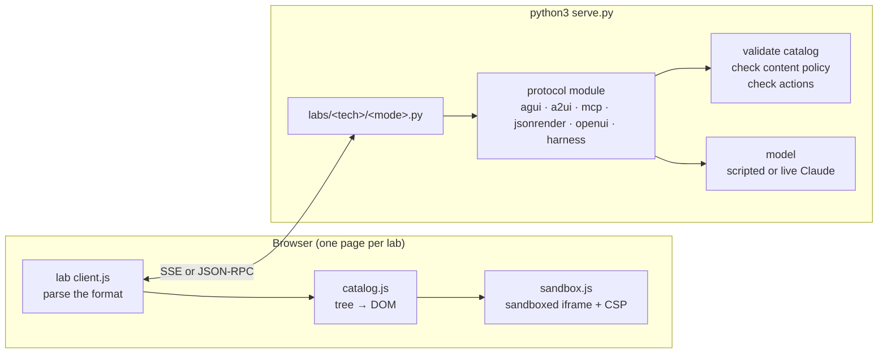
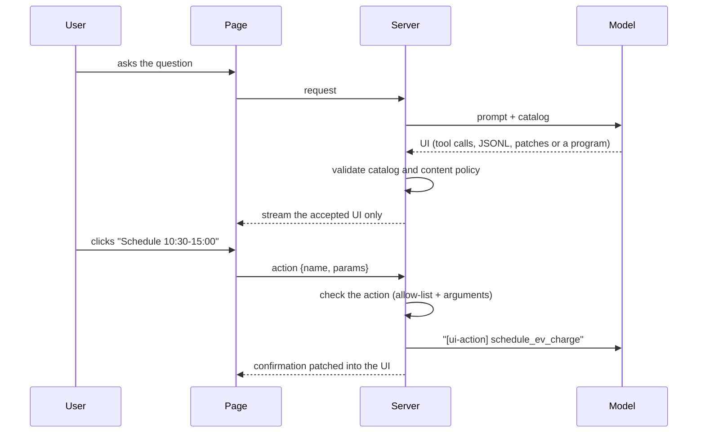
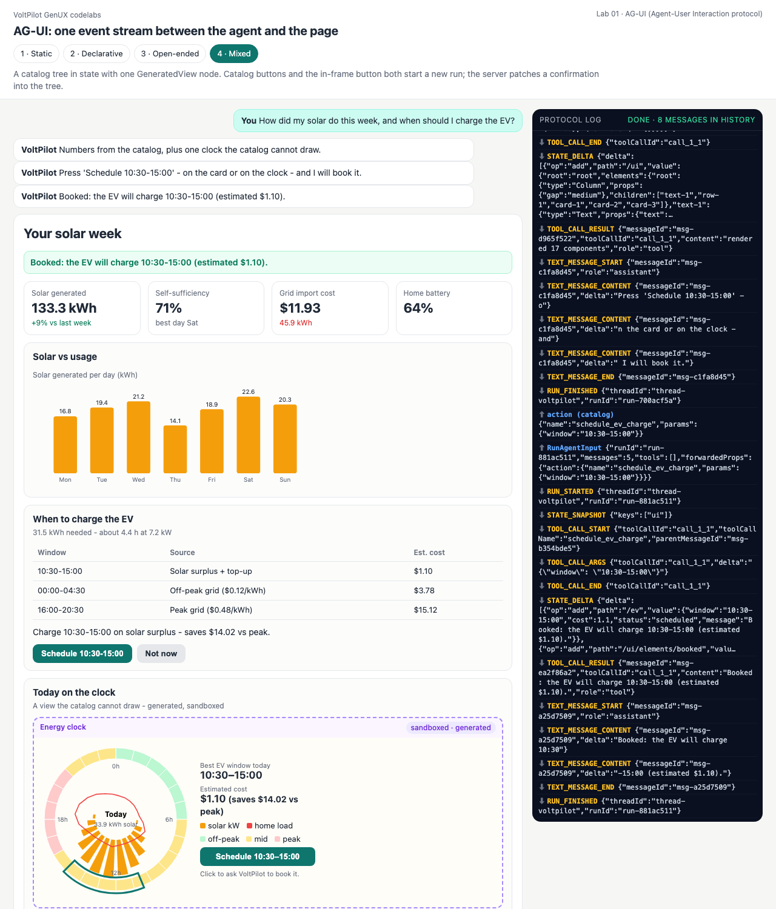
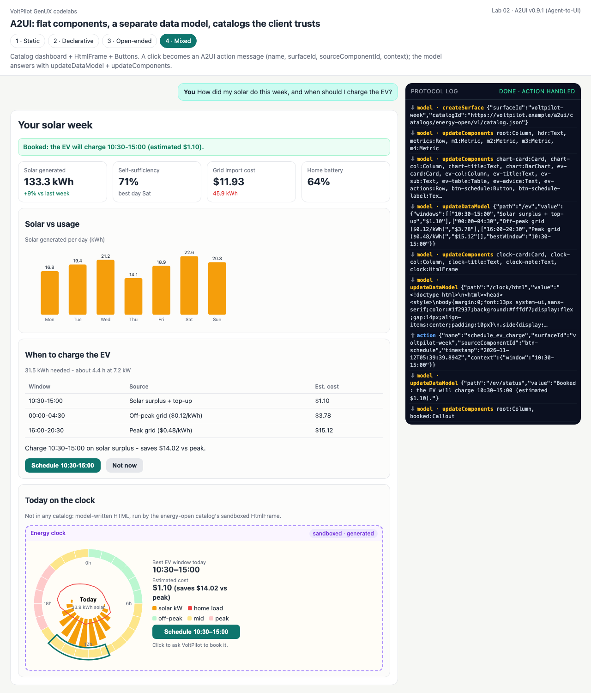
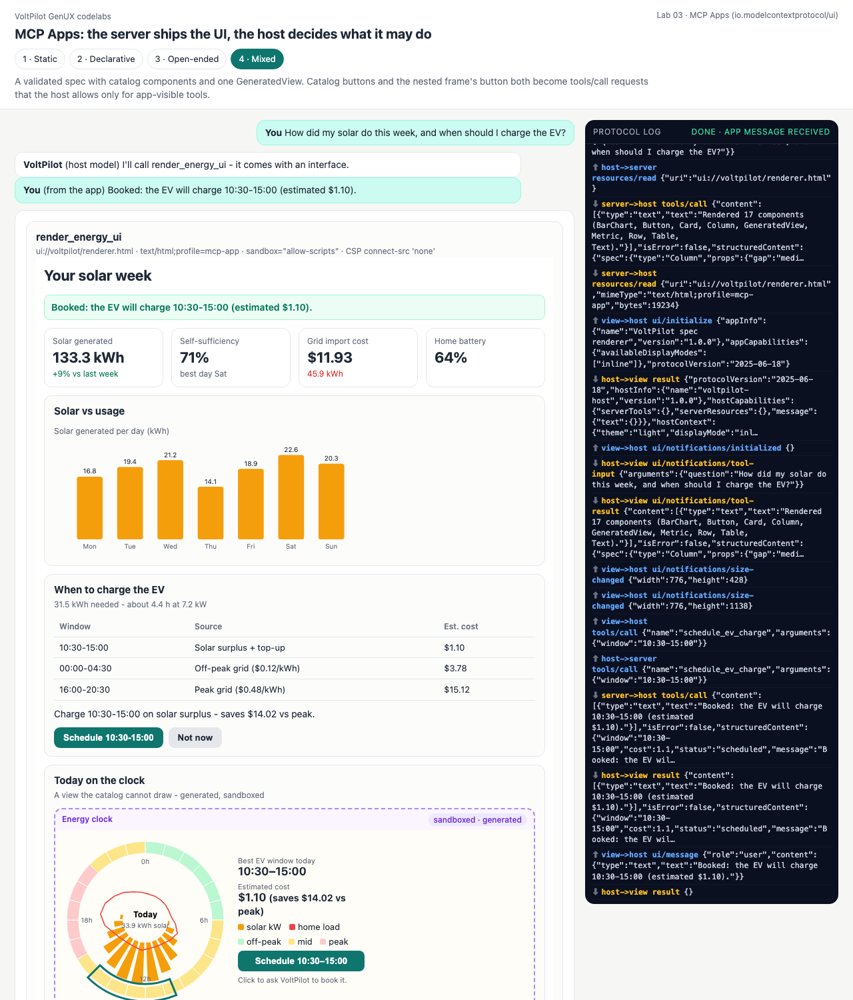
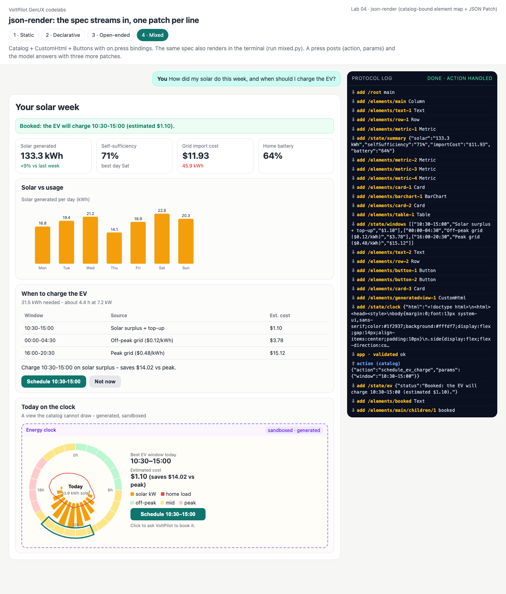
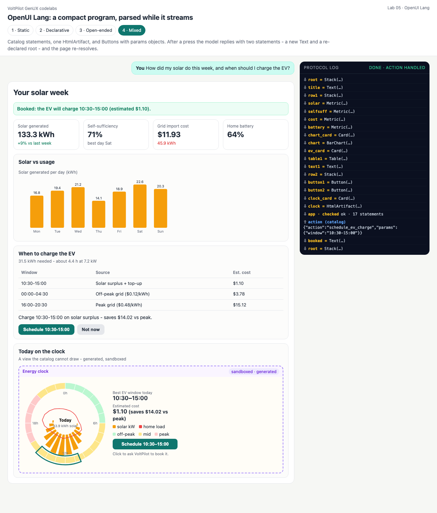
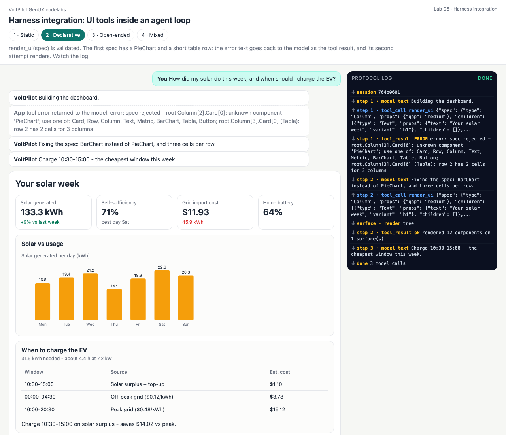

# GenUX Codelabs · Assignment 4

**Six generative-UI technologies, each in four generation modes, on one running example.**

**Technologies:** A2UI · AG-UI · MCP Apps · json-render · OpenUI Lang · harness integration<br>
**Modes:** static · declarative · open-ended · mixed

nitishsjsucs · SJSU · CMPE · November 2026 ·
Reference course: [dlmastery/simple-coding-harness/genui](https://github.com/dlmastery/simple-coding-harness/tree/main/genui)

---

## At a glance

- **One question.** A home-energy agent called *VoltPilot* is asked:
  *"How did my solar do this week, and when should I charge the EV?"*
- **28 runnable demos.** 6 technologies × 4 modes = 24 codelabs, plus one protocol-free foundations lab.
- **Every demo comes with** a terminal transcript, a web page, a screenshot and a code walkthrough.
- **Runs offline.** Python standard library and a scripted model; `--live` swaps in Claude behind the same code.

### Verified

| Check | Result |
|---|---|
| All demos (`run_all.py`) | 28 / 28 pass |
| Tests (`run_tests.py`) | 73 Python + 11 JavaScript pass |
| Official `@ag-ui/core` | all 504 emitted AG-UI events are valid |
| Official `@modelcontextprotocol/sdk` | its client drives our MCP server in 4 / 4 modes |
| Official `@openuidev/lang-core` | parses our programs into the same trees as our parser |
| Official `@json-render/core` | our specs are valid, 0 prop-resolution mismatches |

---

## Contents

1. [The two decisions](#the-two-decisions)
2. [The lab matrix](#the-lab-matrix)
3. [Quick start](#quick-start)
4. [How it fits together](#how-it-fits-together)
5. [Technology by technology](#technology-by-technology)
6. [Comparison](#comparison)
7. [Security model](#security-model)
8. [Testing and verification](#testing-and-verification)
9. [Live mode with Claude](#live-mode-with-claude)
10. [Videos](#videos)
11. [Repository layout](#repository-layout)
12. [Limitations](#limitations)
13. [Credits](#credits)

---

## The two decisions

A generative UI answers two **separate** questions. Mixing them up is the most common confusion in this space
("is A2UI a competitor of AG-UI?" No).

### Decision 1: how much of the interface may the model decide?

| Mode | The model produces | The app still guarantees | Model output for VoltPilot |
|---|---|---|---:|
| **Static** | the *name* of a prebuilt component, plus its props | layout, look, behaviour | 166 bytes |
| **Declarative** | a tree of components from an allowed **catalog** | every node is a known component with valid props | 1,499 bytes |
| **Open-ended** | the markup itself (HTML + JS) | only a sandbox and a content policy | 3,262 bytes |
| **Mixed** | a catalog tree with **one** sandboxed generated region | the catalog everywhere outside that region | 5,531 bytes |

### Decision 2: how does the UI reach the user?

This is where the six technologies differ.

| Technology | What it is | Its unit of exchange |
|---|---|---|
| **AG-UI** | a *transport*: typed agent ↔ page events over SSE, with shared state | events (`TOOL_CALL_*`, `STATE_DELTA`, `CUSTOM` …) |
| **A2UI** | a declarative *format*: surfaces, flat components, a separate data model | 4 envelope messages |
| **MCP Apps** | a *host integration*: an MCP tool ships a `ui://` page that a host mounts | JSON-RPC over `postMessage` |
| **json-render** | a declarative *format*: a catalog-bound element map, streamed as JSON Patch | RFC 6902 patch lines |
| **OpenUI Lang** | a compact *language*: one `name = Component(args)` statement per line | program lines |
| **Harness** | the *agent loop*: UI tools inside a tool-calling harness, two surfaces | tool calls |

Each lab crosses one technology with all four modes.

---

## The lab matrix

Each cell links to that mode's walkthrough. Every lab README also links to its terminal transcripts in
[`docs/outputs/`](docs/outputs).

| | Static | Declarative | Open-ended | Mixed |
|---|---|---|---|---|
| **[00 Foundations](labs/00_foundations/README.md)** | [component + props](labs/00_foundations/README.md#1--static) | [catalog tree](labs/00_foundations/README.md#2--declarative) | [HTML in a sandbox](labs/00_foundations/README.md#3--open-ended) | [tree + GeneratedView](labs/00_foundations/README.md#4--mixed--and-what-each-mode-costs) |
| **[01 AG-UI](labs/01_ag_ui/README.md)** | [frontend tools](labs/01_ag_ui/README.md#1--static--frontend-tools-render-prebuilt-components) | [UI as shared state](labs/01_ag_ui/README.md#2--declarative--the-ui-tree-is-shared-state) | [`CUSTOM` HTML event](labs/01_ag_ui/README.md#3--open-ended--generated-html-in-a-custom-event) | [state tree + new runs](labs/01_ag_ui/README.md#4--mixed--catalog-tree--one-generatedview--actions) |
| **[02 A2UI](labs/02_a2ui/README.md)** | [app surface, model data](labs/02_a2ui/README.md#1--static--the-developer-ships-the-surface-the-model-fills-data) | [model-written surface](labs/02_a2ui/README.md#2--declarative--the-model-writes-the-surface) | [custom `HtmlFrame`](labs/02_a2ui/README.md#3--open-ended--htmlframe-from-a-custom-catalog) | [+ A2UI actions](labs/02_a2ui/README.md#4--mixed--catalog--htmlframe--the-action-round-trip) |
| **[03 MCP Apps](labs/03_mcp_apps/README.md)** | [hand-written view](labs/03_mcp_apps/README.md#1--static--developer-written-view-data-only-result) | [spec + generic view](labs/03_mcp_apps/README.md#2--declarative--server-side-model-validated-spec-generic-view) | [nested sandbox](labs/03_mcp_apps/README.md#3--open-ended--generated-html-nested-sandbox) | [+ app-only tool](labs/03_mcp_apps/README.md#4--mixed--catalog-spec--nested-generatedview--app-only-tool) |
| **[04 json-render](labs/04_json_render/README.md)** | [app spec, model state](labs/04_json_render/README.md#1--static) | [spec as patch stream](labs/04_json_render/README.md#2--declarative) | [`CustomHtml`](labs/04_json_render/README.md#3--open-ended) | [two renderers](labs/04_json_render/README.md#4--mixed--one-spec-two-renderers) |
| **[05 OpenUI Lang](labs/05_openui/README.md)** | [typed templates](labs/05_openui/README.md#1--static--templates-with-typed-slots) | [streamed forward refs](labs/05_openui/README.md#2--declarative--forward-references-while-streaming) | [`HtmlArtifact`](labs/05_openui/README.md#3--open-ended--htmlartifact) | [edits are more program](labs/05_openui/README.md#4--mixed--an-edit-is-more-program) |
| **[06 Harness](labs/06_harness/README.md)** | [`show_component`](labs/06_harness/README.md#1--static) | [self-correcting `render_ui`](labs/06_harness/README.md#2--declarative--the-self-correction-loop) | [`render_html` artifact](labs/06_harness/README.md#3--open-ended--artifact--terminal-fallback) | [clicks back into the loop](labs/06_harness/README.md#4--mixed--clicks-injected-into-the-loop) |

---

## Quick start

Needs Python 3.9+ and nothing else. Node 22 is used only for the JavaScript tests and the optional conformance check.

```bash
git clone https://github.com/nitishsjsucs/genux-codelabs-assignment-4.git
cd genux-codelabs-assignment-4

python3 run_all.py                    # run all 28 demos offline, transcripts -> docs/outputs/
python3 run_tests.py                  # 73 Python + 11 JavaScript tests
python3 labs/03_mcp_apps/mixed.py     # run a single demo
python3 serve.py                      # web pages at http://127.0.0.1:8765
```

Each page plays its scenario on load. Two URL options:

- `&delay=0` streams instantly.
- `&auto=1` clicks the first action button for you, so the full round trip plays.

---

## How it fits together



**One canonical tree.** Every wire format is converted to the same `{type, props, children}` tree over a
nine-component catalog (Card, Row, Column, Text, Metric, BarChart, Table, Button, GeneratedView). That tree is what
gets validated ([common/catalog.py:71](common/catalog.py#L71)) and drawn ([web](common/web/catalog.js#L89),
[terminal](common/term.py#L31)). So across the 24 cells, only the format and the transport change.

**The interaction loop** every mixed-mode lab implements:



### The running example

All numbers live in [common/data.py](common/data.py); a test checks that every day balances and that every
fixture quotes them.

| This week | Value |
|---|---|
| Solar generated | 133.3 kWh (+9%) |
| Self-sufficiency | 71% |
| Grid import cost | $11.93 |
| Home battery | 64% |
| Best EV charge window | 10:30–15:00 on solar surplus, ≈ $1.10 (off-peak ≈ $3.78, peak ≈ $15.12) |

The open-ended region is the same in every lab: a model-written **24-hour radial "energy clock"**
([energy_clock.html](common/fixtures/energy_clock.html)), something no catalog component can draw.

---

## Technology by technology

Each section: the four modes in one table, the key piece of code, real captured output, and a screenshot
(click to expand).

### 00 · Foundations

No transport: one model call, one JSON reply. The whole trust decision is
[`handle()` in foundations.py:61](labs/00_foundations/foundations.py#L61):

```python
    if mode in ("declarative", "mixed"):
        tree = json.loads(reply)
        errors = catalog.validate_tree(tree, allow_generated=(mode == "mixed"))
        return {"mode": mode, "model_output": tree, "errors": errors, "tree": tree if not errors else None}
    problems = sandbox.policy_check(reply)
    return {"mode": mode, "model_output": reply, "errors": problems, "html": reply if not problems else None}
```

**Output**

<!-- output: 00_foundations-mixed from="what each mode" n=6 -->
```text
what each mode lets the model decide, and what it costs in output size:
  mode          bytes  model decides            app guarantees
  static          166  which component + props  layout, look, behaviour
  declarative    1499  layout from the catalog  every component is known
  open_ended     3262  everything (markup + JS) only the sandbox + policy
  mixed          5531  layout + one free region catalog outside the region
```

[Full walkthrough →](labs/00_foundations/README.md)

### 01 · AG-UI

A hand-written AG-UI server ([agui.py](labs/01_ag_ui/agui.py)) and client ([client.js](labs/01_ag_ui/client.js)).

| Mode | What happens |
|---|---|
| Static | The page declares *frontend tools*; the model calls them and the page draws its own components. |
| Declarative | `state.ui` is an element map, built by `STATE_DELTA` JSON Patches. |
| Open-ended | Generated HTML arrives in a `CUSTOM` event. |
| Mixed | A state tree with a `GeneratedView`; each click starts a new run. |

**Key code**: [`run_agent()`, agui.py:181](labs/01_ag_ui/agui.py#L181)

```python
            for call in calls.values():
                if call["name"] in client_tools:
                    waiting_on_client = True  # the page runs it; its result opens the next run
                    continue
                result, ops, extra = execute(server_tools, call, state)
                if ops:
                    apply_patch(state, ops)
                    yield event("STATE_DELTA", delta=ops)
```

**Output** (mixed mode, after the click)

<!-- output: 01_ag_ui-mixed from="click on the catalog" n=12 -->
```text
click on the catalog Button 'Schedule 10:30-15:00' -> RUN 2
  RUN_STARTED           threadId=thread-voltpilot runId=run-1ca95754
  STATE_SNAPSHOT        snapshot keys=['ui']
  TOOL_CALL_START       toolCallId=call_3_1 toolCallName=schedule_ev_charge parentMessageId=msg-25aa908a
  TOOL_CALL_ARGS        x1   {"window": "10:30-15:00"}
  TOOL_CALL_END         toolCallId=call_3_1
  STATE_DELTA           add /ev; add /ui/elements/booked; add /ui/elements/root/children/1
  TOOL_CALL_RESULT      messageId=msg-a4fffe8b toolCallId=call_3_1 content=Booked: the EV will charge 10:30-15:00 (estimated ...
  TEXT_MESSAGE_START    messageId=msg-3c228e3e role=assistant
  TEXT_MESSAGE_CONTENT  x2   Booked: the EV will charge 10:30-15:00 (estimated $1.10).
  TEXT_MESSAGE_END      messageId=msg-3c228e3e
  RUN_FINISHED          threadId=thread-voltpilot runId=run-1ca95754
```

<details>
<summary>Screenshot: AG-UI mixed mode after the click</summary>



</details>

[Full walkthrough →](labs/01_ag_ui/README.md)

### 02 · A2UI

`createSurface`, `updateComponents`, `updateDataModel` and `deleteSurface`, with flat components and JSON-Pointer
data bindings ([a2ui.py](labs/02_a2ui/a2ui.py)).

| Mode | What happens |
|---|---|
| Static | The developer ships the surface; the model may send **only** `updateDataModel`. |
| Declarative | The model writes the whole surface from VoltPilot's energy catalog. |
| Open-ended | A2UI has no "run HTML" component, so a **custom catalog** adds `HtmlFrame`, the sanctioned extension point. |
| Mixed | Catalog components + `HtmlFrame`; buttons come back as A2UI `action` messages. |

**Key code**: the server's gate, [a2ui_surfaces.py:192](labs/02_a2ui/a2ui_surfaces.py#L192)

```python
    for msg in a2ui.jsonl_messages(pieces):
        ...
        kind = a2ui.kind_of(msg)
        if allowed is not None and kind not in allowed:
            yield {"error": f"{kind} refused: in this mode the model may only send {sorted(allowed)}"}
            continue
        problems = client.apply(msg)
```

**Output** (static mode: the model fills data, the app keeps the layout)

<!-- output: 02_a2ui-static from="[model] updateDataModel   /report/advice" n=16 -->
```text
  [model] updateDataModel   /report/advice = Charge 10:30-15:00 on solar surplus - saves $14.02 vs peak.

client state: 9 components, data paths ['report']; missing refs: none
+-------------------------------------------------------------------------
  Weekly energy report
  Solar: 133.3 kWh (+9% vs last week)  |  Self-sufficiency: 71%  |  Grid import cost: $11.93
  Solar per day
     Mon ######################         16.8 kWh
     Tue ##########################     19.4 kWh
     Wed ############################   21.2 kWh
     Thu ###################            14.1 kWh
     Fri #########################      18.9 kWh
     Sat ############################## 22.6 kWh
     Sun ###########################    20.3 kWh
  Charge 10:30-15:00 on solar surplus - saves $14.02 vs peak.
+-------------------------------------------------------------------------
```

<details>
<summary>Screenshot: A2UI mixed mode after the click</summary>



</details>

[Full walkthrough →](labs/02_a2ui/README.md)

### 03 · MCP Apps

A standard-library MCP server (JSON-RPC 2.0 over HTTP **and** stdio). Its tools carry `_meta.ui.resourceUri`, its
`ui://` resources are served as `text/html;profile=mcp-app`, and a browser **host** runs the `postMessage` bridge
([bridge.js](labs/03_mcp_apps/bridge.js)).

| Mode | What happens |
|---|---|
| Static | A hand-written view; the tool returns data only. |
| Declarative | The server's model writes a validated spec; the view is a generic renderer. |
| Open-ended | Generated HTML runs in a **nested** sandbox inside the sandboxed view. |
| Mixed | Spec + nested `GeneratedView` + an **app-only** tool (`visibility: ["app"]`). |

**Key code**: the host's rule, [bridge.js:87](labs/03_mcp_apps/bridge.js#L87)

```js
      case "tools/call":
        if (!viewMayCall(this.tools, params.name)) throw new Error(`the view may not call ${params.name}`);
        return this.callTool(params.name, params.arguments ?? {});
```

**Output** (the view's button calls an app-only tool; a bad argument is refused)

<!-- output: 03_mcp_apps-static from="the view's Schedule" n=6 -->
```text
the view's Schedule button -> tools/call schedule_ev_charge (visibility ['app'])
  view may call: True   model may call: False
  host -> server  tools/call      <- {"content":[{"type":"text","text":"Booked: the EV will charge 10:30-15:00 (estimated $1.10)."}],...
  -> Booked: the EV will charge 10:30-15:00 (estimated $1.10).
  host -> server  tools/call      <- {"content":[{"type":"text","text":"error: unknown charge window '03:00-04:00'; expected one of [...
  bad window -> isError=True: error: unknown charge window '03:00-04:00'; expected one of ['00:00-04:30', '10:30-15:00',
```

<details>
<summary>Screenshot: MCP Apps mixed mode (host page, sandboxed view, nested generated frame)</summary>



</details>

[Full walkthrough →](labs/03_mcp_apps/README.md)

### 04 · json-render

A `{root, elements, state}` spec with `$state` / `$template` expressions and `on.press` actions, streamed as
RFC 6902 patch lines ([jsonrender.py](labs/04_json_render/jsonrender.py)).

| Mode | What happens |
|---|---|
| Static | The developer's spec arrives whole; the model may only `replace /state/...`. |
| Declarative | The model streams the spec, one patch per line. |
| Open-ended | A `CustomHtml` element bound to `/state/clock/html`. |
| Mixed | One spec, **two renderers** (web and terminal), plus actions. |

**Key code**: the write gate, [jsonrender.py:98](labs/04_json_render/jsonrender.py#L98)

```python
    def push(self, op: dict) -> Optional[str]:
        path = op.get("path", "")
        if self.writable and not any(path == p or path.startswith(p + "/") for p in self.writable):
            return f"{op.get('op')} {path} refused: this stream may only write {self.writable}"
```

**Output** (the terminal renderer drawing the same spec as the page)

<!-- output: 04_json_render-mixed from="terminal renderer" n=12 -->
```text
terminal renderer (same spec the page draws):
YOUR SOLAR WEEK
Solar generated: 133.3 kWh (+9% vs last week)  |  Self-sufficiency: 71% (best day Sat)  |  Grid import cost: $11.93 (45.9 kWh)  |  Home battery: 64%
+-- Solar vs usage -------------------------------------------------------
  Solar generated per day
     Mon ######################         16.8 kWh
     Tue ##########################     19.4 kWh
     Wed ############################   21.2 kWh
     Thu ###################            14.1 kWh
     Fri #########################      18.9 kWh
     Sat ############################## 22.6 kWh
     Sun ###########################    20.3 kWh
```

<details>
<summary>Screenshot: json-render mixed mode after the click</summary>



</details>

[Full walkthrough →](labs/04_json_render/README.md)

### 05 · OpenUI Lang

A tokenizer, parser, streaming `Program` and resolver, written twice: in Python ([openui.py](labs/05_openui/openui.py))
and in JavaScript ([openui-parse.js](labs/05_openui/openui-parse.js)). A parity test requires identical trees.

| Mode | What happens |
|---|---|
| Static | Developer templates; the model fills typed slots that can only become **literals**. |
| Declarative | `root` comes first with forward references; placeholders fill in as lines arrive. |
| Open-ended | An `HtmlArtifact` component. |
| Mixed | Catalog + `HtmlArtifact` + Buttons; an edit is just more program. |

**Key code**: [oui_lab.py:43](labs/05_openui/oui_lab.py#L43)

```python
def fill(template: str, values: dict) -> str:
    """The app fills the developer's template. Each value becomes an OpenUI *literal* (json-encoded), so a
    value can never inject a component call or a reference - the model supplies data, not structure."""
```

**Output** (declarative mode: forward references resolve as lines stream in)

<!-- output: 05_openui-declarative from="line  1" n=12 -->
```text
  line  1: root        = Stack        pending refs:  4 (title, row1, chart_card, ev_card)
  line  2: title       = Text         pending refs:  3 (row1, chart_card, ev_card)
  line  3: row1        = Stack        pending refs:  6 (solar, selfsuff, cost, battery, chart_card, ...)
  line  4: solar       = Metric       pending refs:  5 (selfsuff, cost, battery, chart_card, ev_card)
  line  5: selfsuff    = Metric       pending refs:  4 (cost, battery, chart_card, ev_card)
  line  6: cost        = Metric       pending refs:  3 (battery, chart_card, ev_card)
  line  7: battery     = Metric       pending refs:  2 (chart_card, ev_card)
  line  8: chart_card  = Card         pending refs:  2 (chart, ev_card)
  line  9: chart       = BarChart     pending refs:  1 (ev_card)
  line 10: ev_card     = Card         pending refs:  2 (table1, text1)
  line 11: table1      = Table        pending refs:  1 (text1)
  line 12: text1       = Text         pending refs:  0
```

<details>
<summary>Screenshot: OpenUI Lang mixed mode after the click</summary>



</details>

[Full walkthrough →](labs/05_openui/README.md)

### 06 · Harness integration

A bounded tool-calling loop ([harness.py](labs/06_harness/harness.py)) with UI tools and two surfaces: terminal and web.

| Mode | What happens |
|---|---|
| Static | `show_component` over three prebuilt components. |
| Declarative | `render_ui(spec)`: an invalid spec comes back to the model as the tool result, and it fixes itself. |
| Open-ended | `render_html` saves an artifact; the web surface sandboxes it, the terminal prints a fallback. |
| Mixed | Web clicks are injected into the same session as `[ui-action]` turns. |

**Key code**: [hx_tools.py:58](labs/06_harness/hx_tools.py#L58)

```python
        errors = catalog.validate_tree(spec, allow_generated=allow_generated)
        ...
        if errors:  # returned to the model, which fixes the spec on its next step
            return "error: spec rejected - " + "; ".join(errors)
```

**Output** (declarative mode: the rejected spec and the model's correction)

<!-- output: 06_harness-declarative from="step 1 model" n=4 -->
```text
step 1 model: Building the dashboard.
step 1 tool_call  render_ui({"spec": {"type": "Column", "props": {"gap": "medium"}, "children": [{"type": "Text", "props": {"text": "Your ...)
step 1 tool_result ERR error: spec rejected - root.Column[2].Card[0]: unknown component 'PieChart'; use one of: Card, Row, Column, Text, Metric, BarChart, Table, Button; root.Column[3].Card[0] (Table): row 2 has 2 cells for 3 columns
step 2 model: Fixing the spec: BarChart instead of PieChart, and three cells per row.
```

<details>
<summary>Screenshot: harness declarative mode (rejected spec, correction, render)</summary>



</details>

[Full walkthrough →](labs/06_harness/README.md)

---

## Comparison

| | Layer | Who decides the layout | Streaming unit | Open-ended path | Best for |
|---|---|---|---|---|---|
| **AG-UI** | transport | model, via state patches | one event | `CUSTOM` event | connecting any agent to your own app |
| **A2UI** | UI format | model, flat components | one JSONL message | custom-catalog `HtmlFrame` | portable, data-heavy surfaces |
| **MCP Apps** | host integration | server-side model; host mounts | one JSON-RPC result | nested sandbox in the view | UI inside third-party hosts (Claude, Goose) |
| **json-render** | UI format | model, element map | one patch line | `CustomHtml` | streaming dashboards, several renderers |
| **OpenUI Lang** | UI language | model, program | one statement line | `HtmlArtifact` | token-lean model output |
| **Harness** | agent loop | model, via `render_ui` | one tool call | `render_html` artifact | coding agents; CLI + web from one loop |

Where each lab enforces its rules:

| | Validation point | Security boundary |
|---|---|---|
| **AG-UI** | server tool (`add_component`, `render_ui`) | page sandbox + server action check |
| **A2UI** | relay: envelope + catalog + mode policy | trusted catalog + sandbox |
| **MCP Apps** | server before returning; host checks visibility | host iframe CSP + visibility + nested sandbox |
| **json-render** | `SpecStream` write gate + catalog | write gate + sandbox |
| **OpenUI Lang** | parser + catalog | literal-only slots + sandbox |
| **Harness** | the UI tool's result | tool results + session action check |

---

## Security model

1. **Generated markup never touches the app's DOM.** It runs in `sandbox="allow-scripts"`, never with
   `allow-same-origin`, so the frame has an opaque origin: no cookies, no storage, no parent access
   ([sandbox.js:37](common/web/sandbox.js#L37)).
2. **A strict CSP comes before the first model byte.** `default-src 'none'; connect-src 'none'; form-action 'none'; …`
   is injected ahead of anything the model wrote ([sandbox.py:56](common/sandbox.py#L56)).
3. **One message shape out.** A frame can only send `{type: "voltpilot:action", name, params}`. The parent accepts it
   only from that frame, only with an opaque origin, and only for allow-listed names
   ([`isActionMessage`](common/web/sandbox.js#L27)).
4. **A click is a request, not a permission.** The server re-checks the action name *and its arguments* before any
   model call ([labkit.py:26](common/labkit.py#L26)). MCP Apps adds the host's `visibility` rule.
5. **Lint, then sandbox.** `policy_check()` refuses documents that load remote URLs, open connections, submit forms,
   touch storage, navigate the parent or nest frames ([sandbox.py:48](common/sandbox.py#L48)).

> **A sandbox reduces capabilities; it does not make model output safe.** A sandboxed page can still show a wrong
> number or a convincing fake form. That is why *mixed* is the recommended default: reviewed catalog components for
> everything they can express, generated markup only for the region they cannot.

---

## Testing and verification

```bash
python3 run_tests.py      # Python unittest + node --test
```

<!-- output: run_tests from="== Python" n=10 -->
```text
== Python: python3 -m unittest discover -s tests
Ran 73 tests in 1.536s

OK

== JavaScript: node --test tests/js/common.test.mjs tests/js/labs.test.mjs
11/11 passed

summary: python OK (73 tests) · javascript 11/11 passed
```

| Suite | What it proves |
|---|---|
| [test_common.py](tests/test_common.py) | data balances; JSON Patch; specific catalog errors; sandbox policy and CSP placement |
| [test_ag_ui.py](tests/test_ag_ui.py) | event fields and lifecycle; client tools end the run; deltas build a valid tree |
| [test_a2ui.py](tests/test_a2ui.py) | envelope validation; static mode refuses `updateComponents`; `HtmlFrame` only on the custom catalog |
| [test_mcp_apps.py](tests/test_mcp_apps.py) | JSON-RPC handshake; `ui://` resources; CSP; visibility; the **stdio transport** in a subprocess |
| [test_json_render.py](tests/test_json_render.py) | expressions; patch-stream round trip; half a spec renders; the write gate |
| [test_openui.py](tests/test_openui.py) | parser; forward refs; cycles; template injection; **Python ↔ JS parser parity** |
| [test_harness.py](tests/test_harness.py) | self-correction; the step bound; failures are results; artifacts; sessions |
| [test_server_and_labs.py](tests/test_server_and_labs.py) | every API route answers; path traversal is refused; **all 28 demos exit 0** |
| [tests/js/](tests/js) | JS JSON Patch, sandbox message filter, SSE framing, A2UI store, OpenUI parser, MCP host bridge |

### Conformance with the official packages

Optional (needs npm once): `cd conformance && ./check.sh`. Details in [conformance/README.md](conformance/README.md);
full output in [docs/outputs/conformance.txt](docs/outputs/conformance.txt).

| Package | What was checked | Result |
|---|---|---|
| `@ag-ui/core` | every event our AG-UI server emitted, against the official event schemas | 504 valid, 0 invalid |
| `@modelcontextprotocol/sdk` | the official client against our stdio MCP server, all four modes | 4 / 4 modes OK |
| `@openuidev/lang-core` | the official parser on our four OpenUI programs | same trees as ours, 0 unresolved |
| `@json-render/core` | `validateSpec` and prop resolution on our four specs | valid, 0 mismatches |

**Screenshots** are taken with headless Chrome against the running server (`python3 tools/screenshots.py`), with
`&delay=0&auto=1` so each action round trip is included. All 28 are in [docs/screenshots/](docs/screenshots).

---

## Live mode with Claude

Every demo and the server accept `--live`: the same code, with [`LiveClaude`](common/llm.py#L69) in place of the
scripted model.

```bash
python3.12 -m pip install -r requirements-live.txt     # the Anthropic SDK needs Python 3.10+
export ANTHROPIC_API_KEY=...
python3.12 labs/06_harness/declarative.py --live
python3.12 serve.py --live
```

- **Model:** `claude-opus-5-5` by default; override with `VOLTPILOT_MODEL`.
- **Behaviour:** text streams token by token; tool inputs arrive when the turn completes.
- **Not run for this submission.** There was no API key in the build environment, so every recorded output comes from
  the scripted model. A live model's layouts and wording will differ, and it will sometimes produce invalid specs,
  which the declarative paths are built to report back to it.

---

## Videos

One recording per part, following [docs/VIDEO_SCRIPT.md](docs/VIDEO_SCRIPT.md) (what to open, run and point at).

| Part | Topic | YouTube |
|---|---|---|
| 0 | Introduction, the two decisions, foundations lab | *link to be added* |
| 1 | AG-UI: all four modes | *link to be added* |
| 2 | A2UI: all four modes | *link to be added* |
| 3 | MCP Apps: all four modes | *link to be added* |
| 4 | json-render: all four modes | *link to be added* |
| 5 | OpenUI Lang: all four modes | *link to be added* |
| 6 | Harness integration: all four modes, tests and conformance | *link to be added* |

---

## Repository layout

```text
genux-codelabs-assignment-4/
├── serve.py                one standard-library server for every page and API route
├── run_all.py              run the 28 demos offline -> docs/outputs/
├── run_tests.py            Python unittest + node --test
├── common/                 shared by every lab
│   ├── data.py             VoltPilot's numbers
│   ├── catalog.py          the component catalog + validate_tree()
│   ├── sandbox.py          content policy + CSP
│   ├── labkit.py           action allow-list
│   ├── llm.py              ScriptedModel | LiveClaude
│   ├── term.py             terminal renderer
│   └── web/                catalog.js, sandbox.js, jsonpatch.js, sse.js, style.css
├── labs/
│   ├── 00_foundations/
│   ├── 01_ag_ui/           agui.py, client.js
│   ├── 02_a2ui/            a2ui.py, a2ui_surfaces.py
│   ├── 03_mcp_apps/        mcp_server.py, bridge.js, views/
│   ├── 04_json_render/     jsonrender.py, static_spec.json
│   ├── 05_openui/          openui.py, openui-parse.js, templates/
│   └── 06_harness/         harness.py, hx_tools.py
├── tests/                  8 Python suites + tests/js
├── conformance/            optional checks against the official packages
├── tools/                  screenshots.py, embed_outputs.py
└── docs/                   outputs/, screenshots/, VIDEO_SCRIPT.md
```

Every lab folder has the same shape: four mode files (`static.py`, `declarative.py`, `open_ended.py`, `mixed.py`)
that each run as a CLI demo and serve the web page, one protocol module, one `client.js`, one `index.html` and a README.

---

## Limitations

- **Scripted model.** Recorded runs use fixed replies, so they are reproducible and free. They show the protocols and
  the checks, not a model's design taste. Live mode is implemented but was not run.
- **Re-implementations, not the official renderers.** Each format and transport is written from scratch so every byte
  is visible. They are checked against the official AG-UI, MCP, OpenUI and json-render packages, but the official
  React/Lit renderers are not used, and A2UI is checked only by our own validator.
- **Subsets.** A2UI: no `checks`, templates or functions. json-render: no `repeat` or `$bindState`.
  OpenUI Lang: no reactive state. AG-UI: no `MESSAGES_SNAPSHOT` or thinking events. MCP Apps: no display modes or
  `ui/open-link`.
- **No real MCP host tested.** The server works with the official SDK client over stdio; it was not tried inside
  Claude Desktop or Goose.
- **Coarse security lint.** `policy_check()` is a regex lint, not a sanitizer; treat it and the sandbox as defence in depth.
- **Size, not speed.** Byte counts are characters, not tokens, and say nothing about latency.
- **Local demo server.** `serve.py` binds to 127.0.0.1 and keeps sessions in memory.

---

## Credits

- **Course:** the GenUX lecture and Assignment 4 by Vijay Eranti.
- **Protocol reference:** [dlmastery/simple-coding-harness: genui](https://github.com/dlmastery/simple-coding-harness/tree/main/genui).
  This repository is an independent re-implementation around a new running example; no code is copied.
- **Specifications:** [AG-UI](https://docs.ag-ui.com) · [A2UI](https://a2ui.org) ·
  [MCP Apps](https://modelcontextprotocol.io/extensions/apps/overview) ·
  [json-render](https://github.com/vercel-labs/json-render) · [OpenUI](https://github.com/thesysdev/openui)
- Built with AI-assisted coding (Claude Code); every demo was run and every screenshot checked.

MIT License, see [LICENSE](LICENSE).
