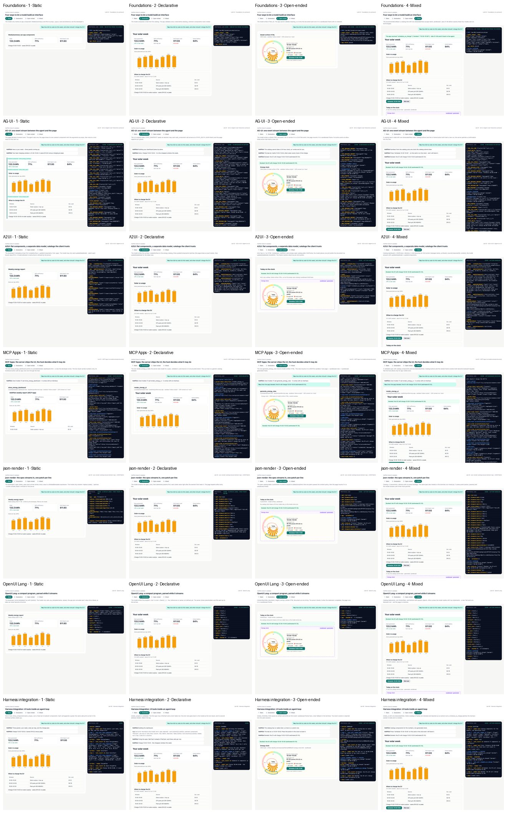
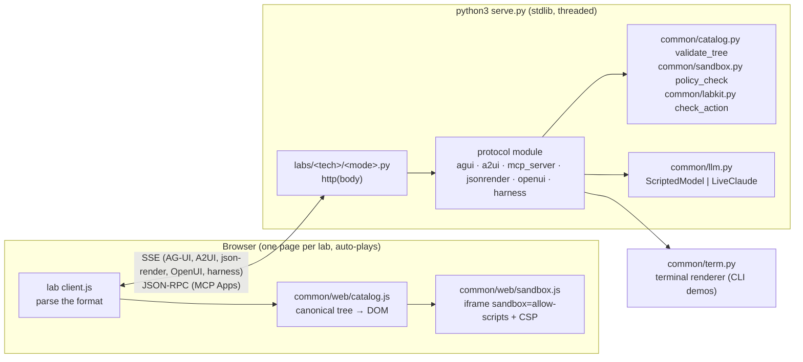
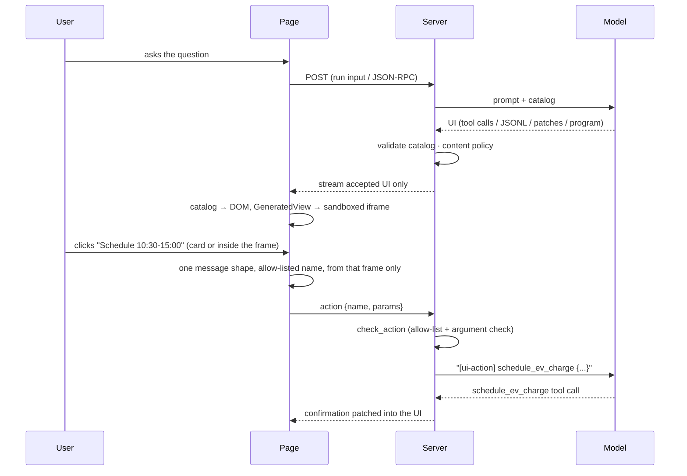
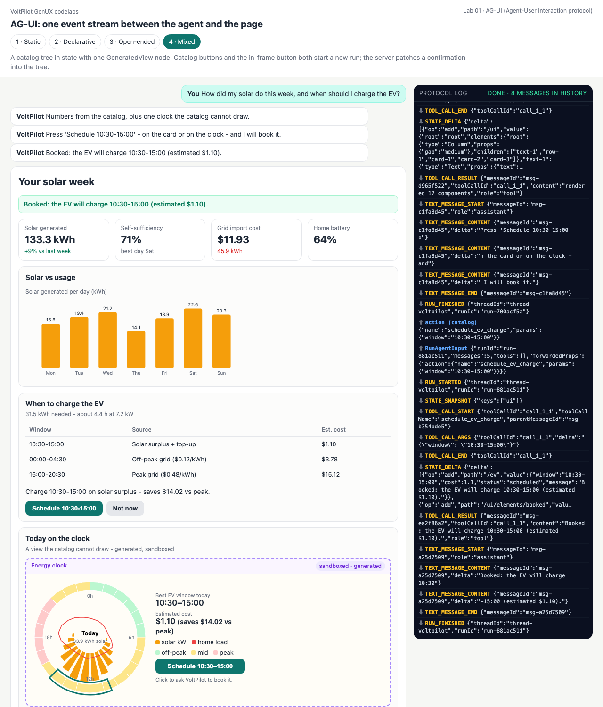
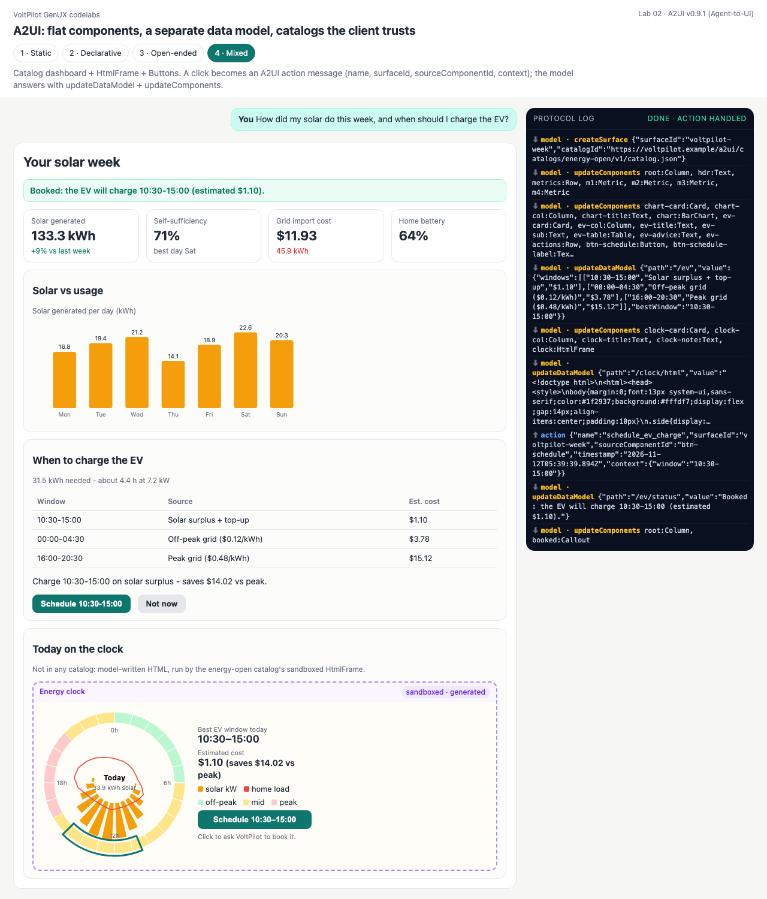
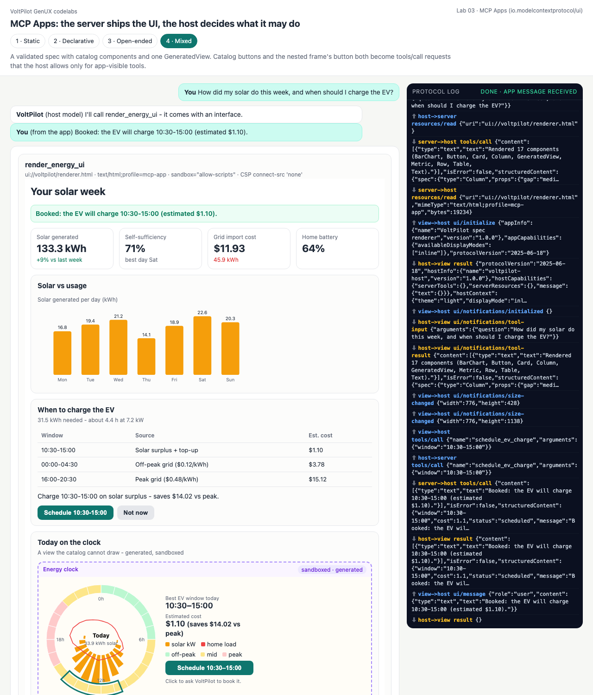
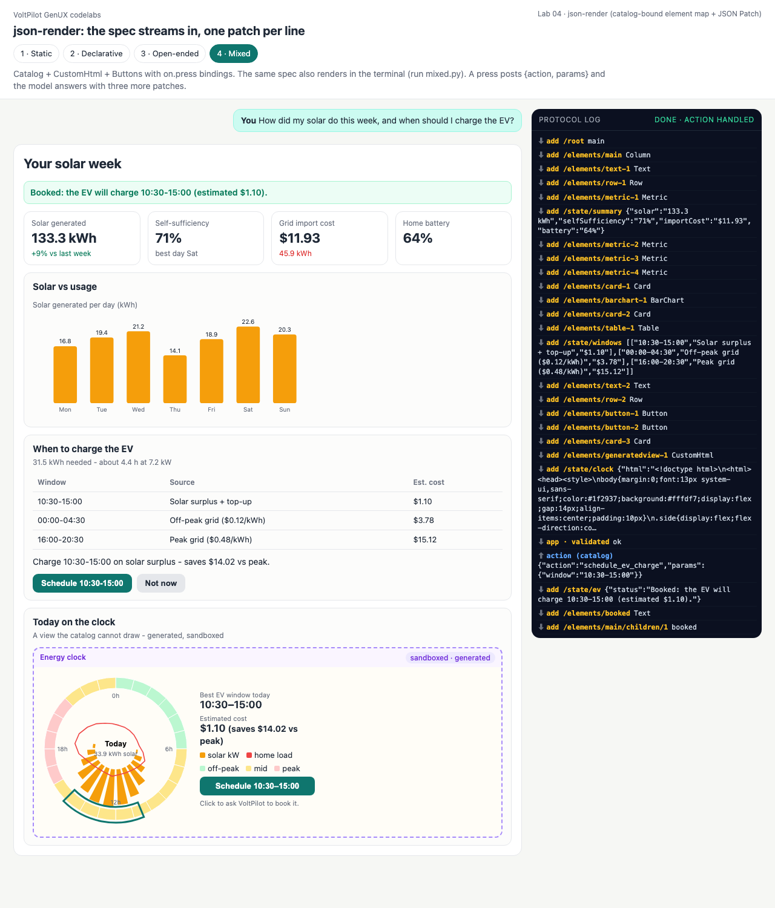
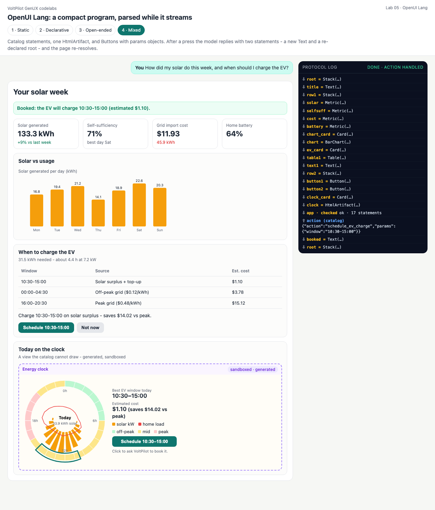
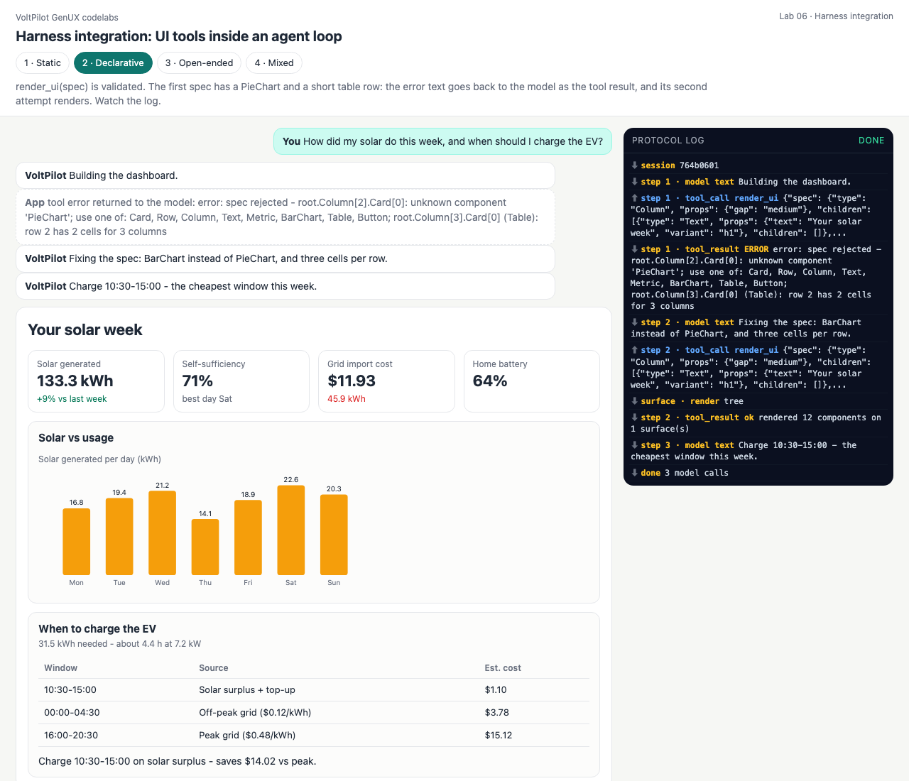

# GenUX Codelabs — Assignment 4: A2UI, AG-UI, MCP Apps, json-render, OpenUI & harness integration

One question — *"How did my solar do this week, and when should I charge the EV?"* — answered by an agent called **VoltPilot** through **six generative-UI technologies**, each in **all four generation modes** (static, declarative, open-ended, mixed). That is 24 codelabs, plus a protocol-free foundations lab that defines the vocabulary: **28 runnable demos, each with a terminal transcript, a live web page, a screenshot and a code walkthrough.** Everything runs offline with the Python standard library and a scripted model; `--live` puts Claude behind the same code.

Author: **nitishsjsucs** · SJSU · CMPE · November 2026 · Reference course: [dlmastery/simple-coding-harness/genui](https://github.com/dlmastery/simple-coding-harness/tree/main/genui)



**Verified in this repo** (commands and outputs below): 28/28 demos pass · 73 Python tests + 11 JavaScript tests pass · the hand-written protocol code agrees with the **official** SDKs — `@ag-ui/core` validates all 504 emitted AG-UI events, the `@modelcontextprotocol/sdk` client drives our Python MCP server in all 4 modes, `@openuidev/lang-core` parses our OpenUI programs into the same trees as our parser, and `@json-render/core` validates our specs with 0 prop-resolution mismatches.

---

## Contents

1. [The two decisions](#the-two-decisions)
2. [The 7 × 4 lab matrix](#the-7--4-lab-matrix)
3. [Quick start](#quick-start)
4. [Architecture](#architecture)
5. [Technology by technology](#technology-by-technology) — [Foundations](#lab-00--foundations) · [AG-UI](#lab-01--ag-ui) · [A2UI](#lab-02--a2ui) · [MCP Apps](#lab-03--mcp-apps) · [json-render](#lab-04--json-render) · [OpenUI Lang](#lab-05--openui-lang) · [Harness](#lab-06--harness-integration)
6. [Comparison](#comparison)
7. [Security model](#security-model)
8. [Testing and verification](#testing-and-verification)
9. [Live mode with Claude](#live-mode-with-claude)
10. [Videos](#videos)
11. [Repository layout](#repository-layout)
12. [Limitations](#limitations)
13. [Credits](#credits)

---

## The two decisions

Building a generative UI means answering two **separate** questions. Mixing them up is the most common confusion in this space ("is A2UI a competitor of AG-UI?" — no).

**Decision 1 — how much of the interface may the model decide?**

| Mode | The model produces | The application keeps | Measured model output for VoltPilot |
|---|---|---|---:|
| **1 · Static** | the *name* of a component the app already has, plus its props | layout, look, behaviour | 166 bytes |
| **2 · Declarative** | a tree of components from an allowed **catalog** | every node is a known component with valid props | 1,499 bytes |
| **3 · Open-ended** | the markup itself (HTML + JS) | only a sandbox and a content policy | 3,262 bytes |
| **4 · Mixed** | a catalog tree with **one** sandboxed generated region | the catalog everywhere outside that region | 5,531 bytes |

**Decision 2 — how does the UI reach the user?** That is what the six technologies differ in:

| Technology | What it is | Its unit |
|---|---|---|
| **AG-UI** | a *transport*: typed agent↔page events over SSE, with shared state | events (`TOOL_CALL_*`, `STATE_DELTA`, `CUSTOM`…) |
| **A2UI** | a declarative *format*: surfaces, flat components, a separate data model, trusted catalogs | 4 envelope messages |
| **MCP Apps** | a *host integration*: an MCP tool ships a `ui://` HTML resource that a host mounts and bridges | JSON-RPC over `postMessage` |
| **json-render** | a declarative *format*: catalog-bound element map + state, streamed as JSON Patch | RFC 6902 patch lines |
| **OpenUI Lang** | a compact *language*: one `name = Component(args)` statement per line | program lines |
| **Harness integration** | the *agent loop*: UI tools inside a tool-calling harness with several surfaces | tool calls + surface events |

Each lab crosses one row of the second table with every row of the first.

## The 7 × 4 lab matrix

Every cell links to its walkthrough section; **▶** opens the page (with `python3 serve.py` running), **⌨** is the captured terminal transcript.

| | 1 · Static | 2 · Declarative | 3 · Open-ended | 4 · Mixed |
|---|---|---|---|---|
| **[00 Foundations](labs/00_foundations/README.md)** — no protocol | [app component + props](labs/00_foundations/README.md#1--static) · [▶](http://127.0.0.1:8765/labs/00_foundations/?mode=static) [⌨](docs/outputs/00_foundations-static.txt) | [catalog tree](labs/00_foundations/README.md#2--declarative) · [▶](http://127.0.0.1:8765/labs/00_foundations/?mode=declarative) [⌨](docs/outputs/00_foundations-declarative.txt) | [HTML in a sandbox](labs/00_foundations/README.md#3--open-ended) · [▶](http://127.0.0.1:8765/labs/00_foundations/?mode=open_ended) [⌨](docs/outputs/00_foundations-open_ended.txt) | [tree + GeneratedView](labs/00_foundations/README.md#4--mixed--and-what-each-mode-costs) · [▶](http://127.0.0.1:8765/labs/00_foundations/?mode=mixed) [⌨](docs/outputs/00_foundations-mixed.txt) |
| **[01 AG-UI](labs/01_ag_ui/README.md)** | [frontend tools](labs/01_ag_ui/README.md#1--static--frontend-tools-render-prebuilt-components) · [▶](http://127.0.0.1:8765/labs/01_ag_ui/?mode=static) [⌨](docs/outputs/01_ag_ui-static.txt) | [UI as shared state](labs/01_ag_ui/README.md#2--declarative--the-ui-tree-is-shared-state) · [▶](http://127.0.0.1:8765/labs/01_ag_ui/?mode=declarative) [⌨](docs/outputs/01_ag_ui-declarative.txt) | [`CUSTOM` HTML event](labs/01_ag_ui/README.md#3--open-ended--generated-html-in-a-custom-event) · [▶](http://127.0.0.1:8765/labs/01_ag_ui/?mode=open_ended) [⌨](docs/outputs/01_ag_ui-open_ended.txt) | [state tree + new runs](labs/01_ag_ui/README.md#4--mixed--catalog-tree--one-generatedview--actions) · [▶](http://127.0.0.1:8765/labs/01_ag_ui/?mode=mixed) [⌨](docs/outputs/01_ag_ui-mixed.txt) |
| **[02 A2UI](labs/02_a2ui/README.md)** | [app template, model data](labs/02_a2ui/README.md#1--static--the-developer-ships-the-surface-the-model-fills-data) · [▶](http://127.0.0.1:8765/labs/02_a2ui/?mode=static) [⌨](docs/outputs/02_a2ui-static.txt) | [model-written surface](labs/02_a2ui/README.md#2--declarative--the-model-writes-the-surface) · [▶](http://127.0.0.1:8765/labs/02_a2ui/?mode=declarative) [⌨](docs/outputs/02_a2ui-declarative.txt) | [custom-catalog HtmlFrame](labs/02_a2ui/README.md#3--open-ended--htmlframe-from-a-custom-catalog) · [▶](http://127.0.0.1:8765/labs/02_a2ui/?mode=open_ended) [⌨](docs/outputs/02_a2ui-open_ended.txt) | [+ A2UI actions](labs/02_a2ui/README.md#4--mixed--catalog--htmlframe--the-action-round-trip) · [▶](http://127.0.0.1:8765/labs/02_a2ui/?mode=mixed) [⌨](docs/outputs/02_a2ui-mixed.txt) |
| **[03 MCP Apps](labs/03_mcp_apps/README.md)** | [hand-written ui:// view](labs/03_mcp_apps/README.md#1--static--developer-written-view-data-only-result) · [▶](http://127.0.0.1:8765/labs/03_mcp_apps/?mode=static) [⌨](docs/outputs/03_mcp_apps-static.txt) | [spec + generic view](labs/03_mcp_apps/README.md#2--declarative--server-side-model-validated-spec-generic-view) · [▶](http://127.0.0.1:8765/labs/03_mcp_apps/?mode=declarative) [⌨](docs/outputs/03_mcp_apps-declarative.txt) | [nested sandbox](labs/03_mcp_apps/README.md#3--open-ended--generated-html-nested-sandbox) · [▶](http://127.0.0.1:8765/labs/03_mcp_apps/?mode=open_ended) [⌨](docs/outputs/03_mcp_apps-open_ended.txt) | [+ app-only tool](labs/03_mcp_apps/README.md#4--mixed--catalog-spec--nested-generatedview--app-only-tool) · [▶](http://127.0.0.1:8765/labs/03_mcp_apps/?mode=mixed) [⌨](docs/outputs/03_mcp_apps-mixed.txt) |
| **[04 json-render](labs/04_json_render/README.md)** | [app spec, model state](labs/04_json_render/README.md#1--static) · [▶](http://127.0.0.1:8765/labs/04_json_render/?mode=static) [⌨](docs/outputs/04_json_render-static.txt) | [spec as patch stream](labs/04_json_render/README.md#2--declarative) · [▶](http://127.0.0.1:8765/labs/04_json_render/?mode=declarative) [⌨](docs/outputs/04_json_render-declarative.txt) | [CustomHtml](labs/04_json_render/README.md#3--open-ended) · [▶](http://127.0.0.1:8765/labs/04_json_render/?mode=open_ended) [⌨](docs/outputs/04_json_render-open_ended.txt) | [two renderers + actions](labs/04_json_render/README.md#4--mixed--one-spec-two-renderers) · [▶](http://127.0.0.1:8765/labs/04_json_render/?mode=mixed) [⌨](docs/outputs/04_json_render-mixed.txt) |
| **[05 OpenUI Lang](labs/05_openui/README.md)** | [templates + typed slots](labs/05_openui/README.md#1--static--templates-with-typed-slots) · [▶](http://127.0.0.1:8765/labs/05_openui/?mode=static) [⌨](docs/outputs/05_openui-static.txt) | [forward refs, streamed](labs/05_openui/README.md#2--declarative--forward-references-while-streaming) · [▶](http://127.0.0.1:8765/labs/05_openui/?mode=declarative) [⌨](docs/outputs/05_openui-declarative.txt) | [HtmlArtifact](labs/05_openui/README.md#3--open-ended--htmlartifact) · [▶](http://127.0.0.1:8765/labs/05_openui/?mode=open_ended) [⌨](docs/outputs/05_openui-open_ended.txt) | [edits are more program](labs/05_openui/README.md#4--mixed--an-edit-is-more-program) · [▶](http://127.0.0.1:8765/labs/05_openui/?mode=mixed) [⌨](docs/outputs/05_openui-mixed.txt) |
| **[06 Harness](labs/06_harness/README.md)** | [show_component](labs/06_harness/README.md#1--static) · [▶](http://127.0.0.1:8765/labs/06_harness/?mode=static) [⌨](docs/outputs/06_harness-static.txt) | [render_ui self-correction](labs/06_harness/README.md#2--declarative--the-self-correction-loop) · [▶](http://127.0.0.1:8765/labs/06_harness/?mode=declarative) [⌨](docs/outputs/06_harness-declarative.txt) | [render_html artifact](labs/06_harness/README.md#3--open-ended--artifact--terminal-fallback) · [▶](http://127.0.0.1:8765/labs/06_harness/?mode=open_ended) [⌨](docs/outputs/06_harness-open_ended.txt) | [clicks injected into the loop](labs/06_harness/README.md#4--mixed--clicks-injected-into-the-loop) · [▶](http://127.0.0.1:8765/labs/06_harness/?mode=mixed) [⌨](docs/outputs/06_harness-mixed.txt) |

## Quick start

Python 3.9+ and nothing else (Node 22 only for the JS tests and the optional conformance check).

```bash
git clone https://github.com/nitishsjsucs/genux-codelabs-assignment-4.git && cd genux-codelabs-assignment-4
```

```bash
python3 run_all.py        # all 28 demos offline -> docs/outputs/*.txt
```

```bash
python3 serve.py          # http://127.0.0.1:8765 - every page auto-plays its scenario
```

Page options: `&delay=0` streams instantly, `&auto=1` clicks the first action button by itself so the round trip plays without you. One demo: `python3 labs/03_mcp_apps/mixed.py`. All checks: `python3 run_tests.py`.

## Architecture



Every wire format is converted to **one canonical tree** — `{type, props, children}` over a nine-component catalog (Card, Row, Column, Text, Metric, BarChart, Table, Button, GeneratedView) — before it is validated ([common/catalog.py:71](common/catalog.py#L71)) or drawn ([common/web/catalog.js:89](common/web/catalog.js#L89), [common/term.py:31](common/term.py#L31)). That is what makes the 24 cells comparable: only the format and the transport change.

**The interaction loop** every mixed-mode lab implements:



**Running example.** [common/data.py](common/data.py) holds one home's week: 133.3 kWh of solar (+9%), 71% self-sufficiency, $11.93 of grid imports, a 64% battery, and three EV charge windows (10:30–15:00 on solar surplus ≈ $1.10, off-peak ≈ $3.78, peak ≈ $15.12). `tests/test_common.py` checks that every day balances (use = self-consumed solar + import) and that every fixture quotes these numbers. The open-ended region in every lab is the same model-written **24-hour radial "energy clock"** ([common/fixtures/energy_clock.html](common/fixtures/energy_clock.html)) — something no catalog component can draw.

---

## Technology by technology

### Lab 00 · Foundations

No transport: one model call, one JSON reply. [`handle()` — foundations.py:61](labs/00_foundations/foundations.py#L61) is the whole trust decision:

```python
    if mode in ("declarative", "mixed"):
        tree = json.loads(reply)
        errors = catalog.validate_tree(tree, allow_generated=(mode == "mixed"))
        return {"mode": mode, "model_output": tree, "errors": errors, "tree": tree if not errors else None}
    problems = sandbox.policy_check(reply)
    return {"mode": mode, "model_output": reply, "errors": problems, "html": reply if not problems else None}
```

<!-- output: 00_foundations-mixed from="what each mode" n=6 -->
```text
what each mode lets the model decide, and what it costs in output size:
  mode          bytes  model decides            app guarantees
  static          166  which component + props  layout, look, behaviour
  declarative    1499  layout from the catalog  every component is known
  open_ended     3262  everything (markup + JS) only the sandbox + policy
  mixed          5531  layout + one free region catalog outside the region
```

→ [Full walkthrough](labs/00_foundations/README.md)

### Lab 01 · AG-UI

A hand-written AG-UI server ([agui.py](labs/01_ag_ui/agui.py)) and client ([client.js](labs/01_ag_ui/client.js)). **Static:** the page declares *frontend tools*; the model calls them and the page draws its own components. **Declarative:** `state.ui` is an element map built by `STATE_DELTA` JSON Patches. **Open-ended:** generated HTML rides in a `CUSTOM` event. **Mixed:** a state tree with a `GeneratedView`; clicks start a new run. The core decision in [`run_agent()` — agui.py:181](labs/01_ag_ui/agui.py#L181):

```python
            for call in calls.values():
                if call["name"] in client_tools:
                    waiting_on_client = True  # the page runs it; its result opens the next run
                    continue
                result, ops, extra = execute(server_tools, call, state)
                if ops:
                    apply_patch(state, ops)
                    yield event("STATE_DELTA", delta=ops)
```

<!-- output: 01_ag_ui-mixed from="click on the catalog" n=12 -->
```text
click on the catalog Button 'Schedule 10:30-15:00' -> RUN 2
  RUN_STARTED           threadId=thread-voltpilot runId=run-9d875cb7
  STATE_SNAPSHOT        snapshot keys=['ui']
  TOOL_CALL_START       toolCallId=call_3_1 toolCallName=schedule_ev_charge parentMessageId=msg-72d1e8cb
  TOOL_CALL_ARGS        x1   {"window": "10:30-15:00"}
  TOOL_CALL_END         toolCallId=call_3_1
  STATE_DELTA           add /ev; add /ui/elements/booked; add /ui/elements/root/children/1
  TOOL_CALL_RESULT      messageId=msg-3e060893 toolCallId=call_3_1 content=Booked: the EV will charge 10:30-15:00 (estimated ...
  TEXT_MESSAGE_START    messageId=msg-cf021f9d role=assistant
  TEXT_MESSAGE_CONTENT  x2   Booked: the EV will charge 10:30-15:00 (estimated $1.10).
  TEXT_MESSAGE_END      messageId=msg-cf021f9d
  RUN_FINISHED          threadId=thread-voltpilot runId=run-9d875cb7
```



→ [Full walkthrough](labs/01_ag_ui/README.md)

### Lab 02 · A2UI

`createSurface` / `updateComponents` / `updateDataModel` / `deleteSurface` with flat components and JSON-Pointer bindings ([a2ui.py](labs/02_a2ui/a2ui.py)). **Static:** the developer ships the surface and the model may send **only** `updateDataModel`. **Declarative:** the model writes the surface on VoltPilot's energy catalog. **Open-ended:** A2UI has no "run HTML" component, so a **custom catalog** adds `HtmlFrame` — the sanctioned extension point. **Mixed:** buttons return as A2UI `action` messages. The server's gate, [a2ui_surfaces.py:192](labs/02_a2ui/a2ui_surfaces.py#L192):

```python
    for msg in a2ui.jsonl_messages(pieces):
        ...
        kind = a2ui.kind_of(msg)
        if allowed is not None and kind not in allowed:
            yield {"error": f"{kind} refused: in this mode the model may only send {sorted(allowed)}"}
            continue
        problems = client.apply(msg)
```

<!-- output: 02_a2ui-static from="[model] updateDataModel   /report/advice" n=16 -->
```text
  [model] updateDataModel   /report/advice = Charge 10:30-15:00 on solar surplus - saves $14.02 vs peak.

client state: 9 components, data paths ['report']; missing refs: none
+-------------------------------------------------------------------------
  Weekly energy report
  Solar: 133.3 kWh (+9% vs last week)  |  Self-sufficiency: 71%  |  Grid import cost: $11.93
  Solar per day
     Mon ######################         16.8 kWh
     Tue ##########################     19.4 kWh
     Wed ############################   21.2 kWh
     Thu ###################            14.1 kWh
     Fri #########################      18.9 kWh
     Sat ############################## 22.6 kWh
     Sun ###########################    20.3 kWh
  Charge 10:30-15:00 on solar surplus - saves $14.02 vs peak.
+-------------------------------------------------------------------------
```



→ [Full walkthrough](labs/02_a2ui/README.md)

### Lab 03 · MCP Apps

A stdlib MCP server (JSON-RPC 2.0 over HTTP **and** stdio) whose tools carry `_meta.ui.resourceUri`, `ui://` resources served as `text/html;profile=mcp-app`, and a browser **host** with the `postMessage` bridge ([bridge.js](labs/03_mcp_apps/bridge.js)). **Static:** a hand-written view, data-only result. **Declarative:** the server's model writes a validated spec; the view is a generic renderer. **Open-ended:** generated HTML in a **nested** sandbox inside the sandboxed view. **Mixed:** spec + nested GeneratedView + an **app-only** tool (`visibility: ["app"]`). The host's rule, [bridge.js:87](labs/03_mcp_apps/bridge.js#L87):

```js
      case "tools/call":
        if (!viewMayCall(this.tools, params.name)) throw new Error(`the view may not call ${params.name}`);
        return this.callTool(params.name, params.arguments ?? {});
```

<!-- output: 03_mcp_apps-static from="the view's Schedule" n=6 -->
```text
the view's Schedule button -> tools/call schedule_ev_charge (visibility ['app'])
  view may call: True   model may call: False
  host -> server  tools/call      <- {"content":[{"type":"text","text":"Booked: the EV will charge 10:30-15:00 (estimated $1.10)."}],...
  -> Booked: the EV will charge 10:30-15:00 (estimated $1.10).
  host -> server  tools/call      <- {"content":[{"type":"text","text":"error: unknown charge window '03:00-04:00'; expected one of [...
  bad window -> isError=True: error: unknown charge window '03:00-04:00'; expected one of ['00:00-04:30', '10:30-15:00',
```



→ [Full walkthrough](labs/03_mcp_apps/README.md)

### Lab 04 · json-render

`{root, elements, state}` with `$state`/`$template` expressions and `on.press` actions, streamed as RFC 6902 patch lines ([jsonrender.py](labs/04_json_render/jsonrender.py)). **Static:** the developer's spec arrives whole; the model may only `replace /state/...`. **Declarative:** the model streams the spec. **Open-ended:** `CustomHtml` bound to `/state/clock/html`. **Mixed:** one spec, **two renderers** (web and terminal). The static gate, [jsonrender.py:98](labs/04_json_render/jsonrender.py#L98):

```python
    def push(self, op: dict) -> Optional[str]:
        path = op.get("path", "")
        if self.writable and not any(path == p or path.startswith(p + "/") for p in self.writable):
            return f"{op.get('op')} {path} refused: this stream may only write {self.writable}"
```

<!-- output: 04_json_render-mixed from="terminal renderer" n=12 -->
```text
terminal renderer (same spec the page draws):
YOUR SOLAR WEEK
Solar generated: 133.3 kWh (+9% vs last week)  |  Self-sufficiency: 71% (best day Sat)  |  Grid import cost: $11.93 (45.9 kWh)  |  Home battery: 64%
+-- Solar vs usage -------------------------------------------------------
  Solar generated per day
     Mon ######################         16.8 kWh
     Tue ##########################     19.4 kWh
     Wed ############################   21.2 kWh
     Thu ###################            14.1 kWh
     Fri #########################      18.9 kWh
     Sat ############################## 22.6 kWh
     Sun ###########################    20.3 kWh
```



→ [Full walkthrough](labs/04_json_render/README.md)

### Lab 05 · OpenUI Lang

A tokenizer, parser, streaming `Program` and resolver written twice — [openui.py](labs/05_openui/openui.py) and [openui-parse.js](labs/05_openui/openui-parse.js) — and a parity test that requires identical trees. **Static:** developer templates; the model fills typed slots that can only become **literals**. **Declarative:** `root` first with forward references; placeholders fill in as lines arrive. **Open-ended:** `HtmlArtifact`. **Mixed:** catalog + `HtmlArtifact` + Buttons; an edit is just more program. [oui_lab.py:43](labs/05_openui/oui_lab.py#L43):

```python
def fill(template: str, values: dict) -> str:
    """The app fills the developer's template. Each value becomes an OpenUI *literal* (json-encoded), so a
    value can never inject a component call or a reference - the model supplies data, not structure."""
```

<!-- output: 05_openui-declarative from="line  1" n=12 -->
```text
  line  1: root        = Stack        pending refs:  4 (title, row1, chart_card, ev_card)
  line  2: title       = Text         pending refs:  3 (row1, chart_card, ev_card)
  line  3: row1        = Stack        pending refs:  6 (solar, selfsuff, cost, battery, chart_card, ...)
  line  4: solar       = Metric       pending refs:  5 (selfsuff, cost, battery, chart_card, ev_card)
  line  5: selfsuff    = Metric       pending refs:  4 (cost, battery, chart_card, ev_card)
  line  6: cost        = Metric       pending refs:  3 (battery, chart_card, ev_card)
  line  7: battery     = Metric       pending refs:  2 (chart_card, ev_card)
  line  8: chart_card  = Card         pending refs:  2 (chart, ev_card)
  line  9: chart       = BarChart     pending refs:  1 (ev_card)
  line 10: ev_card     = Card         pending refs:  2 (table1, text1)
  line 11: table1      = Table        pending refs:  1 (text1)
  line 12: text1       = Text         pending refs:  0
```



→ [Full walkthrough](labs/05_openui/README.md)

### Lab 06 · Harness integration

A bounded tool-calling loop ([harness.py](labs/06_harness/harness.py)) with UI tools and two surfaces (terminal + web). **Static:** `show_component` over three prebuilt components. **Declarative:** `render_ui(spec)` — an invalid spec comes back to the model as the tool result and it fixes itself. **Open-ended:** `render_html` saves an artifact; the web surface sandboxes it, the terminal prints a fallback. **Mixed:** web clicks are injected into the same session as `[ui-action]` turns. [hx_tools.py:58](labs/06_harness/hx_tools.py#L58):

```python
        errors = catalog.validate_tree(spec, allow_generated=allow_generated)
        ...
        if errors:  # returned to the model, which fixes the spec on its next step
            return "error: spec rejected - " + "; ".join(errors)
```

<!-- output: 06_harness-declarative from="step 1 model" n=4 -->
```text
step 1 model: Building the dashboard.
step 1 tool_call  render_ui({"spec": {"type": "Column", "props": {"gap": "medium"}, "children": [{"type": "Text", "props": {"text": "Your ...)
step 1 tool_result ERR error: spec rejected - root.Column[2].Card[0]: unknown component 'PieChart'; use one of: Card, Row, Column, Text, Metric, BarChart, Table, Button; root.Column[3].Card[0] (Table): row 2 has 2 cells for 3 columns
step 2 model: Fixing the spec: BarChart instead of PieChart, and three cells per row.
```



→ [Full walkthrough](labs/06_harness/README.md)

---

## Comparison

| | AG-UI | A2UI | MCP Apps | json-render | OpenUI Lang | Harness |
|---|---|---|---|---|---|---|
| **Layer** | transport (events + state) | UI format | host integration | UI format | UI language | agent loop |
| **Who decides layout (declarative mode)** | model, via state patches | model, flat components | server-side model; host mounts | model, element map | model, program | model, via `render_ui` |
| **Where validation happens here** | server tool (`add_component`, `render_ui`) | relay: envelope + catalog + mode policy | server before returning; host checks visibility | `SpecStream` gate + catalog at end | parser + catalog at end | the UI tool's result |
| **Streaming unit** | one event | one JSONL message | one JSON-RPC result | one patch line | one statement line | one tool call |
| **Partial render while streaming** | yes (each delta) | yes (each batch; missing children = placeholders) | no (whole result) | yes (each line) | yes (forward refs = placeholders) | per tool call |
| **Open-ended path** | `CUSTOM` event | custom-catalog `HtmlFrame` | nested sandbox in the view | `CustomHtml` | `HtmlArtifact` | `render_html` artifact |
| **Security boundary** | page sandbox + server action check | catalog the client trusts + sandbox | host iframe CSP + visibility + nested sandbox | write-gate + sandbox | literal-only slots + sandbox | tool results + session action check |
| **Best for** | connecting any agent to your own app | portable, data-heavy surfaces | UI inside third-party hosts (Claude, Goose) | streaming dashboards, multiple renderers | token-lean model output | coding agents, CLI + web from one loop |

## Security model

1. **Generated markup never touches the app's DOM.** It is mounted with `sandbox="allow-scripts"` and **never** `allow-same-origin`, so the frame has an opaque origin: no cookies, no storage, no access to the parent ([common/web/sandbox.js:37](common/web/sandbox.js#L37)).
2. **CSP before the first model byte.** `srcdoc()` injects `default-src 'none'; connect-src 'none'; form-action 'none'; …` ahead of anything the model wrote ([common/sandbox.py:56](common/sandbox.py#L56)). In MCP Apps the host applies a second CSP to the view and the view nests the generated document one level deeper.
3. **One message shape out.** The only way out of a frame is `postMessage({type: "voltpilot:action", name, params})`; the parent accepts it only from that frame's window, only with an opaque origin, and only for allow-listed names ([`isActionMessage`](common/web/sandbox.js#L27)).
4. **A click is a request, not a permission.** Every server re-checks the action name *and its arguments* before any model call ([common/labkit.py:26](common/labkit.py#L26)); MCP Apps adds the host's `visibility` rule.
5. **Lint, then sandbox.** `policy_check()` refuses documents that load remote URLs, open connections, submit forms, touch storage, navigate the parent or nest frames ([common/sandbox.py:48](common/sandbox.py#L48)).

**A sandbox reduces capabilities; it does not make model output safe.** A sandboxed document can still display a wrong number or a convincing fake form. That is why the recommended default is *mixed*: catalog components (reviewed code, validated props) for everything the catalog can express, and generated markup only for the region it cannot.

## Testing and verification

```bash
python3 run_tests.py      # Python unittest + node --test
```

<!-- output: run_tests from="== Python" n=10 -->
```text
== Python: python3 -m unittest discover -s tests
Ran 73 tests in 1.536s

OK

== JavaScript: node --test tests/js/common.test.mjs tests/js/labs.test.mjs
11/11 passed

summary: python OK (73 tests) · javascript 11/11 passed
```

| Suite | What it proves |
|---|---|
| [tests/test_common.py](tests/test_common.py) | data balances; JSON Patch; catalog errors are specific; sandbox policy and CSP placement; scripted model |
| [tests/test_ag_ui.py](tests/test_ag_ui.py) | event fields/lifecycle; client tools end the run; 11 deltas build a valid tree; CUSTOM + refused actions |
| [tests/test_a2ui.py](tests/test_a2ui.py) | envelope validation; static mode refuses `updateComponents`; HtmlFrame only on the custom catalog; action reply |
| [tests/test_mcp_apps.py](tests/test_mcp_apps.py) | JSON-RPC handshake; `ui://` resources are intact single-script apps; CSP; visibility; **stdio transport in a subprocess** |
| [tests/test_json_render.py](tests/test_json_render.py) | expressions; patch-stream round trip; half a spec renders; write gate; policy on CustomHtml |
| [tests/test_openui.py](tests/test_openui.py) | parser; forward refs; redefinition; cycles; template injection; **Python ↔ JS parser parity** |
| [tests/test_harness.py](tests/test_harness.py) | self-correction; `MAX_STEPS` bound; failures are results; artifacts; sessions; two surfaces agree |
| [tests/test_server_and_labs.py](tests/test_server_and_labs.py) | every API route answers; path traversal is refused; **all 28 demos exit 0** |
| [tests/js/](tests/js) (node) | JS JSON Patch, sandbox message filter, SSE framing, A2UI store, json-render stream, OpenUI parser, MCP host bridge |

**Official-SDK conformance** (optional, needs npm once): `cd conformance && ./check.sh` — [conformance/README.md](conformance/README.md).

<!-- output: conformance from="@ag-ui/core" n=20 -->
```text
@ag-ui/core EventSchemas: 504 events valid, 0 invalid; RunAgentInputSchema: 7 inputs checked
  by type: RUN_STARTED=7 STATE_SNAPSHOT=7 TEXT_MESSAGE_START=10 TEXT_MESSAGE_CONTENT=24 TEXT_MESSAGE_END=10 TOOL_CALL_START=18 TOOL_CALL_ARGS=373 TOOL_CALL_END=18 RUN_FINISHED=7 STATE_DELTA=14 TOOL_CALL_RESULT=15 CUSTOM=1
  static      server=voltpilot-static tools=[show_energy_dashboard,schedule_ev_charge] call ok=true structured=summary,week,windows resource=text/html;profile=mcp-app 19966B app-only=[schedule_ev_charge]
  declarative server=voltpilot-declarative tools=[render_energy_ui,schedule_ev_charge] call ok=true structured=spec resource=text/html;profile=mcp-app 19234B app-only=[schedule_ev_charge]
  open_ended  server=voltpilot-open-ended tools=[generate_energy_view,schedule_ev_charge] call ok=true structured=title,html,bytes resource=text/html;profile=mcp-app 18942B app-only=[schedule_ev_charge]
  mixed       server=voltpilot-mixed tools=[render_energy_ui,schedule_ev_charge] call ok=true structured=spec resource=text/html;profile=mcp-app 19234B app-only=[schedule_ev_charge]
@modelcontextprotocol/sdk client vs our stdio server: 4/4 modes OK
wrote 4 OpenUI programs and 4 json-render specs to conformance/out/
  openui static      official parse: root=Card unresolved=0 errors=0 statements=7 -> same tree as ours
  openui declarative official parse: root=Stack unresolved=0 errors=0 statements=12 -> same tree as ours
  openui open_ended  official parse: root=Card unresolved=0 errors=0 statements=3 -> same tree as ours
  openui mixed       official parse: root=Stack unresolved=0 errors=0 statements=17 -> same tree as ours
  json-render static      validateSpec valid=true errors=0 warnings=0; official prop resolution vs ours: 0 mismatches
  json-render declarative validateSpec valid=true errors=0 warnings=0; official prop resolution vs ours: 0 mismatches
  json-render open_ended  validateSpec valid=true errors=0 warnings=0; official prop resolution vs ours: 0 mismatches
  json-render mixed       validateSpec valid=true errors=0 warnings=0; official prop resolution vs ours: 0 mismatches
all format checks passed
```

**Screenshots** are taken by headless Chrome against the running server (`python3 tools/screenshots.py`, `&delay=0&auto=1` so the action round trip is included). Each technology's pages were opened and inspected, and `docs/screenshots/contact-sheet.png` (built by `tools/contact_sheet.py`) tiles all 28 for review.

## Live mode with Claude

Every demo and the server accept `--live`: the same code, with [common/llm.py `LiveClaude`](common/llm.py#L69) instead of `ScriptedModel`.

```bash
python3.12 -m pip install -r requirements-live.txt     # the Anthropic SDK needs Python 3.10+
export ANTHROPIC_API_KEY=...                           # or an `ant auth login` profile
python3.12 labs/06_harness/declarative.py --live
python3.12 serve.py --live
```

Defaults: model `claude-opus-5-5` (override with `VOLTPILOT_MODEL`), effort `medium`, server-side refusal fallbacks on (`fallbacks="default"`), text streamed token by token, tool inputs emitted when the turn completes, and the model's own content blocks replayed unchanged on the next turn. **Live mode was not run for this submission** (no API key in the build environment); all recorded outputs come from the scripted model. Expect a live model's layouts and wording to differ, and expect occasional validation errors — which the declarative paths are built to report back.

## Videos

One recording per part, following [docs/VIDEO_SCRIPT.md](docs/VIDEO_SCRIPT.md) (what to open, what to run, what to point at).

| Part | Topic | YouTube |
|---|---|---|
| 0 | Introduction, the two decisions, foundations lab | *link to be added* |
| 1 | AG-UI — all four modes | *link to be added* |
| 2 | A2UI — all four modes | *link to be added* |
| 3 | MCP Apps — all four modes | *link to be added* |
| 4 | json-render — all four modes | *link to be added* |
| 5 | OpenUI Lang — all four modes | *link to be added* |
| 6 | Harness integration — all four modes, tests and conformance | *link to be added* |

## Repository layout

```
genux-codelabs-assignment-4/
├── README.md                  this file
├── serve.py                   one stdlib server for every page and API route
├── run_all.py                 run the 28 demos offline -> docs/outputs/
├── run_tests.py               Python unittest + node --test
├── common/                    shared by every lab
│   ├── data.py  fixtures.py   VoltPilot numbers; the canonical dashboard; fixtures/energy_clock.html
│   ├── catalog.py             the component catalog + validate_tree()
│   ├── sandbox.py  labkit.py  content policy + CSP srcdoc; action allow-list
│   ├── jsonpatch.py  sse.py   RFC 6902; SSE framing
│   ├── llm.py                 ScriptedModel | LiveClaude (Anthropic SDK)
│   ├── term.py  registry.py   terminal renderer; lab loader
│   └── web/                   catalog.js renderer, sandbox.js, jsonpatch.js, sse.js, shell.js, style.css
├── labs/
│   ├── 00_foundations/        static.py declarative.py open_ended.py mixed.py + foundations.py, client.js, README
│   ├── 01_ag_ui/              + agui.py, frontend_tools.json, components.js
│   ├── 02_a2ui/               + a2ui.py, a2ui_surfaces.py, surface.js
│   ├── 03_mcp_apps/           + mcp_server.py, mcp_voltpilot.py, bridge.js, views/
│   ├── 04_json_render/        + jsonrender.py, jr_lab.py, static_spec.json, spec-stream.js
│   ├── 05_openui/             + openui.py, oui_lab.py, templates/*.oui, openui-parse.js
│   └── 06_harness/            + harness.py, hx_tools.py
├── tests/                     8 Python suites + tests/js
├── conformance/               optional checks against @ag-ui/core, @modelcontextprotocol/sdk, @openuidev/lang-core, @json-render/core
├── tools/                     screenshots.py, contact_sheet.py, embed_outputs.py
└── docs/                      outputs/ (transcripts), screenshots/, VIDEO_SCRIPT.md
```

Every lab folder has the same shape: four mode files (`static.py`, `declarative.py`, `open_ended.py`, `mixed.py`) that each run as a CLI demo **and** expose `http()` for the server, one protocol module with a unique name, one `client.js`, one `index.html`, one README.

## Limitations

- **Scripted model.** The recorded runs use fixed replies so they are reproducible and free; they show the *protocol and the checks*, not a model's design taste. Live mode is implemented but was not exercised here.
- **Re-implementations, not the official renderers.** The labs implement each format and transport from scratch so every byte is visible. They are checked against the official AG-UI, MCP, OpenUI and json-render packages (see conformance) but they do not use the official React/Lit renderers, and A2UI messages are checked by our validator, not against the published JSON schemas.
- **Subsets.** A2UI: no `checks`, templates or `formatDate`-style functions. json-render: no `repeat`, `$bindState` or built-in `setState`. OpenUI Lang: no reactive state, queries or mutations. AG-UI: no `MESSAGES_SNAPSHOT` replay, thinking or step events in the demos. MCP Apps: no display modes, `ui/open-link` or resource teardown UI.
- **MCP Apps in real hosts.** The server works with the official SDK client over stdio; it was not tried inside Claude Desktop or Goose.
- **Security.** `policy_check()` is a coarse regex lint, not a sanitizer, and the sandbox/CSP depend on the browser. Treat both as defence in depth.
- **Size, not speed.** Byte counts (166 → 5,531; OpenUI 45% smaller than JSON) are characters, not tokens, and say nothing about end-to-end latency.
- **Local demo server.** `serve.py` binds to 127.0.0.1 and keeps harness sessions in memory; it is not a production server.

## Credits

- Course: the GenUX lecture and Assignment 4 by **Vijay Eranti**. Protocol reference: **[dlmastery/simple-coding-harness — genui](https://github.com/dlmastery/simple-coding-harness/tree/main/genui)**. This repository is an independent re-implementation around a new running example (VoltPilot); no code is copied from the reference.
- Specifications: [AG-UI](https://docs.ag-ui.com) · [A2UI](https://a2ui.org) · [MCP Apps](https://modelcontextprotocol.io/extensions/apps/overview) · [json-render](https://github.com/vercel-labs/json-render) · [OpenUI](https://github.com/thesysdev/openui).
- Built with AI-assisted coding (Claude Code); every demo was run and every screenshot checked.

MIT License — see [LICENSE](LICENSE).
