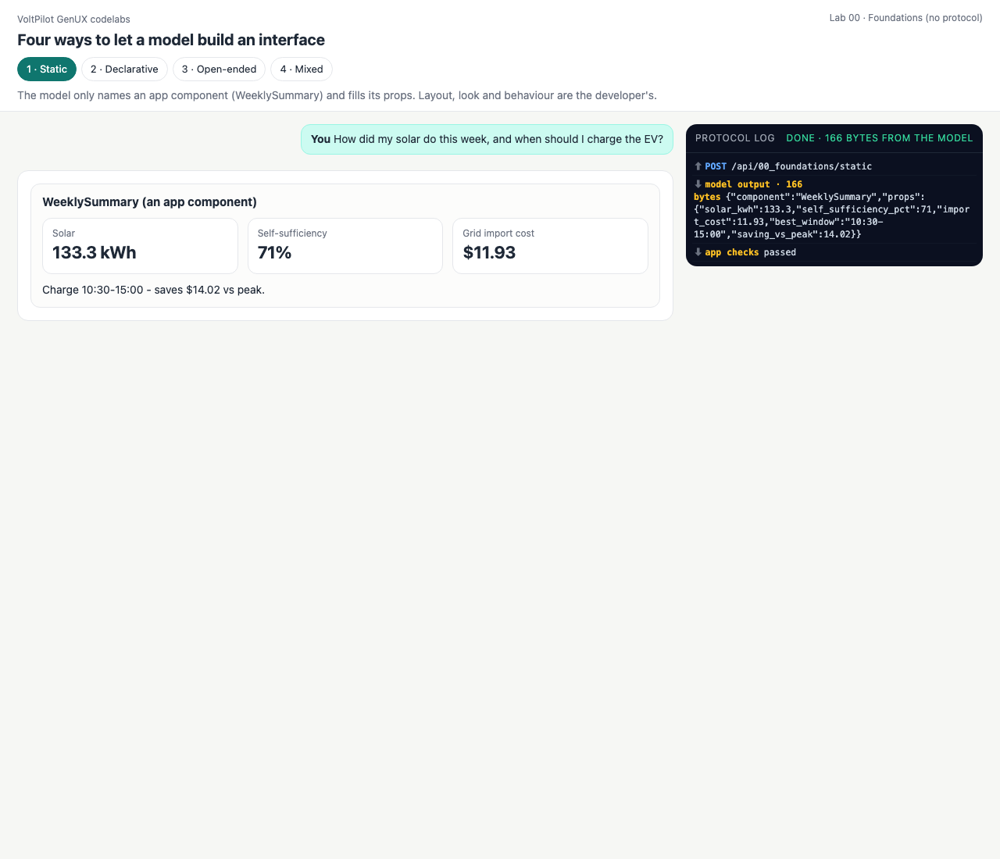
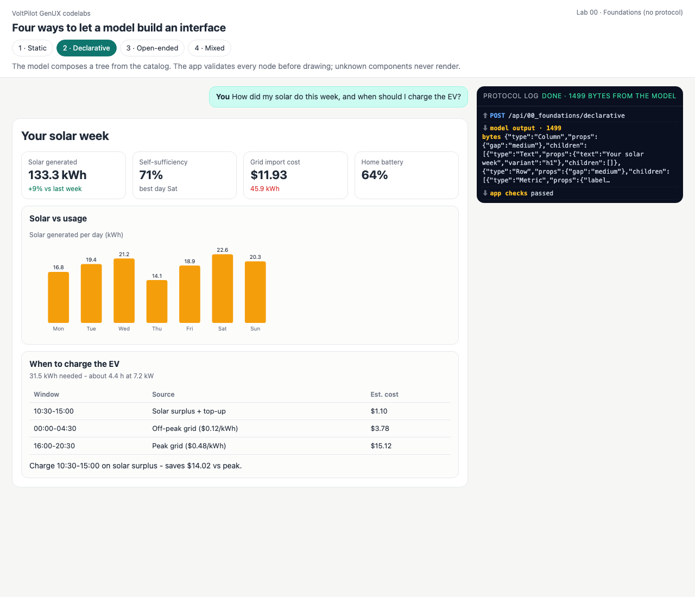
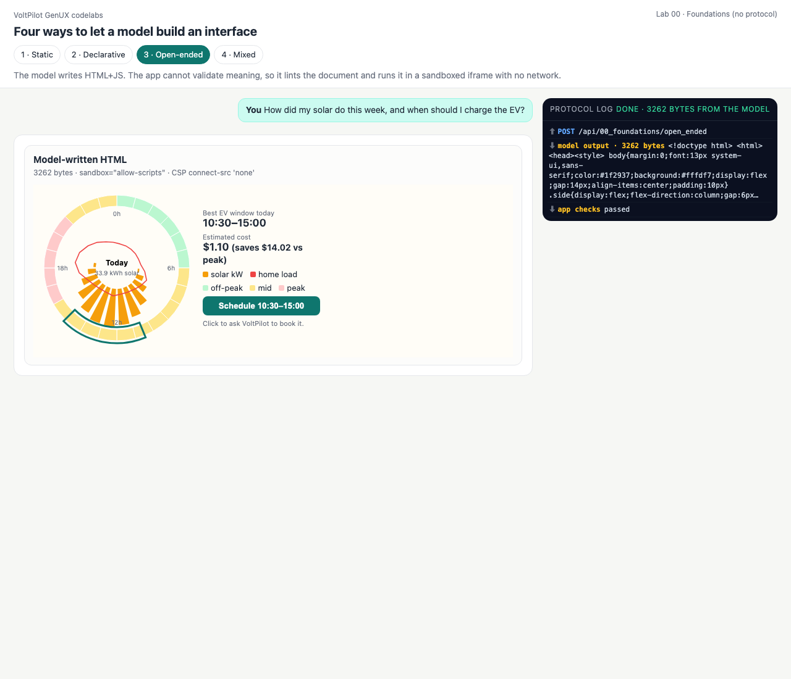
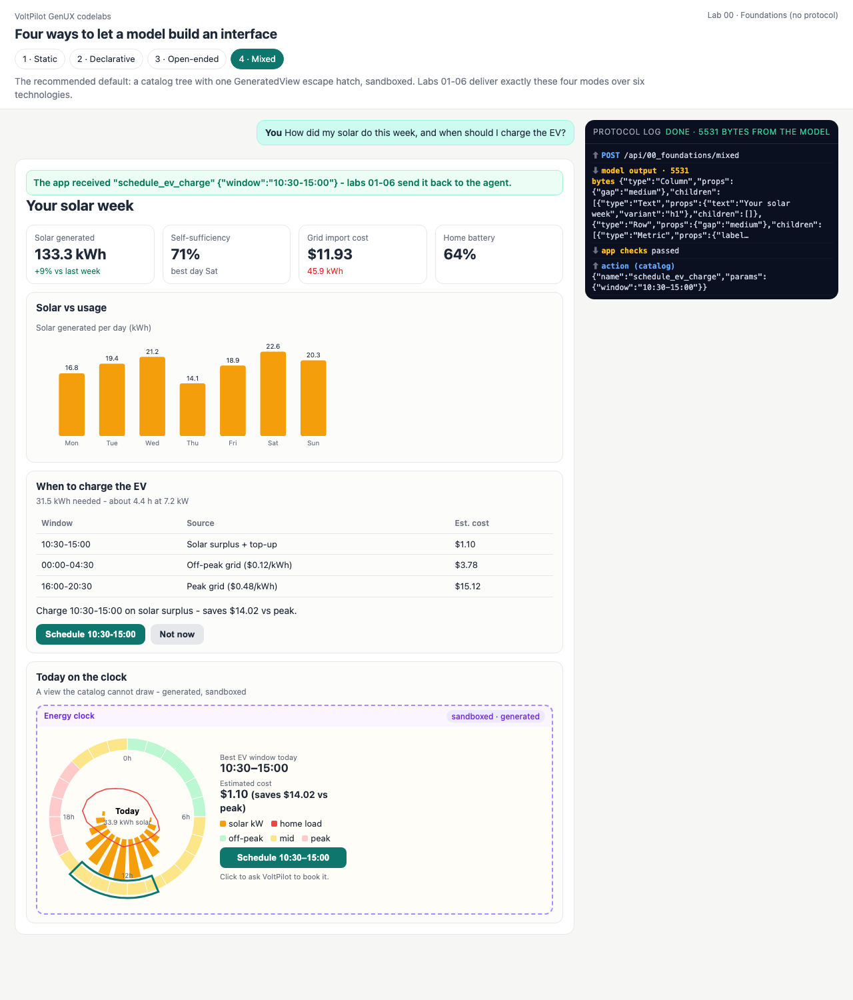

# Lab 00 · Foundations — four ways to let a model build an interface

**No protocol yet.** One model call, one JSON reply, and the application decides how much of it to trust. Every later lab keeps these four modes and changes only *how the UI travels* (events, envelopes, an MCP host, patches, a compact language, an agent loop).

| Mode | The model decides | The app guarantees | Model output (bytes, measured) |
|---|---|---|---:|
| 1 · Static | which **app component** + its props | layout, look, behaviour | 166 |
| 2 · Declarative | a **tree** of catalog components | every node is a known component with valid props | 1,499 |
| 3 · Open-ended | **everything** — HTML + JS | only the sandbox and a content policy | 3,262 |
| 4 · Mixed | a catalog tree + **one** free region | the catalog everywhere outside that region | 5,531 |

Run any mode: `python3 labs/00_foundations/<mode>.py` · page: `python3 serve.py` → <http://127.0.0.1:8765/labs/00_foundations/?mode=static>

## Code walkthrough

All four modes share [foundations.py](foundations.py). The interesting function is `handle()` — the trust decision:

1. **[foundations.py:26](foundations.py#L26) `APP_COMPONENTS`** — static mode's whole contract: one component name and its required props. [`weekly_summary()` (line 31)](foundations.py#L31) is the developer's layout; the model never sees it.
2. **[foundations.py:41](foundations.py#L41) `SCRIPTS`** — the scripted model's four replies. They come from one canonical dashboard ([common/fixtures.py:63](../../common/fixtures.py#L63)) so that every lab shows the same numbers.
3. **[foundations.py:61](foundations.py#L61) `handle(mode, reply)`**
   - *static*: look the component up; missing props are errors; the app draws its own component.
   - *declarative / mixed*: `catalog.validate_tree()` ([common/catalog.py:71](../../common/catalog.py#L71)) checks every node — unknown type, missing or mistyped prop, enum values, chart label/value counts, table row widths, and **button actions outside the allow-list**. Mixed passes `allow_generated=True`, so exactly one extra type (`GeneratedView`) becomes legal.
   - *open-ended*: there is nothing to validate structurally, so `sandbox.policy_check()` ([common/sandbox.py:48](../../common/sandbox.py#L48)) rejects documents that load remote URLs, open connections, submit forms, touch storage or navigate the parent.
4. **The browser half** — [client.js](client.js) paints trees with the shared renderer ([common/web/catalog.js:89](../../common/web/catalog.js#L89)) and mounts HTML with `mountSandbox()` ([common/web/sandbox.js:37](../../common/web/sandbox.js#L37)): `sandbox="allow-scripts"` (never `allow-same-origin`), a CSP `<meta>` injected *before* the model's first byte, and a `postMessage` listener that accepts one message shape from that one frame.

## Captured output

### 1 · Static
<!-- output: 00_foundations-static from="model output" n=8 -->
```text
model output (166 bytes): {"component": "WeeklySummary", "props": {"solar_kwh": 133.3, "self_sufficiency_pct": 71, "import_cost": 11.93, "best_window": "10:30-15:00", "saving_vs_peak": 1...
app checks: passed
app renders (terminal renderer):
+-- WeeklySummary (an app component) -------------------------------------
  Solar: 133.3 kWh  |  Self-sufficiency: 71%  |  Grid import cost: $11.93
  Charge 10:30-15:00 - saves $14.02 vs peak.
+-------------------------------------------------------------------------
```

### 2 · Declarative
<!-- output: 00_foundations-declarative from="model output" n=14 -->
```text
model output (1499 bytes): {"type": "Column", "props": {"gap": "medium"}, "children": [{"type": "Text", "props": {"text": "Your solar week", "variant": "h1"}, "children": []}, {"type": "R...
app checks: passed
app renders (terminal renderer):
YOUR SOLAR WEEK
Solar generated: 133.3 kWh (+9% vs last week)  |  Self-sufficiency: 71% (best day Sat)  |  Grid import cost: $11.93 (45.9 kWh)  |  Home battery: 64%
+-- Solar vs usage -------------------------------------------------------
  Solar generated per day
     Mon ######################         16.8 kWh
     Tue ##########################     19.4 kWh
     Wed ############################   21.2 kWh
     Thu ###################            14.1 kWh
     Fri #########################      18.9 kWh
     Sat ############################## 22.6 kWh
     Sun ###########################    20.3 kWh
```

### 3 · Open-ended
<!-- output: 00_foundations-open_ended from="model output" n=3 -->
```text
model output (3262 bytes): <!doctype html>
<html><head><style>
body{margin:0;font:13px system-ui,sans-serif;color:#1f2937;background:#fffdf7;display:flex;gap:14px;align-items:center;paddi...
```

### 4 · Mixed — and what each mode costs
<!-- output: 00_foundations-mixed from="what each mode" n=6 -->
```text
what each mode lets the model decide, and what it costs in output size:
  mode          bytes  model decides            app guarantees
  static          166  which component + props  layout, look, behaviour
  declarative    1499  layout from the catalog  every component is known
  open_ended     3262  everything (markup + JS) only the sandbox + policy
  mixed          5531  layout + one free region catalog outside the region
```

| Static | Declarative | Open-ended | Mixed |
|---|---|---|---|
|  |  |  |  |

## Quiz

1. **Why is "the model returned valid JSON" not enough to draw a declarative tree?**
   <details><summary>Answer</summary>Parsing checks syntax only. The app must still check that every type is in the catalog, every prop has the right type, and every action is allowed — `validate_tree()` does exactly that.</details>
2. **The open-ended mode passes `policy_check`. Is the HTML now safe?**
   <details><summary>Answer</summary>No. The sandbox and lint *reduce capabilities* (no network, no parent DOM, no storage); the document can still show a misleading number or a fake form. That is why mixed mode is the recommended default: generated markup only where the catalog runs out.</details>
3. **Which mode would you pick for a bank's transfer screen, and why?**
   <details><summary>Answer</summary>Static: the layout and the action wiring are reviewed code; the model only fills values.</details>
