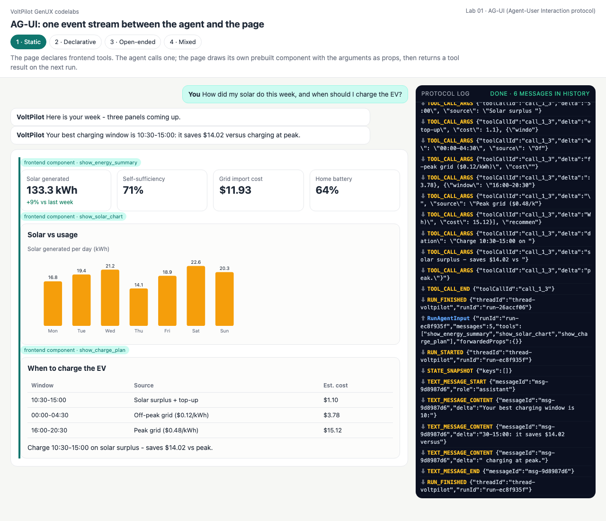
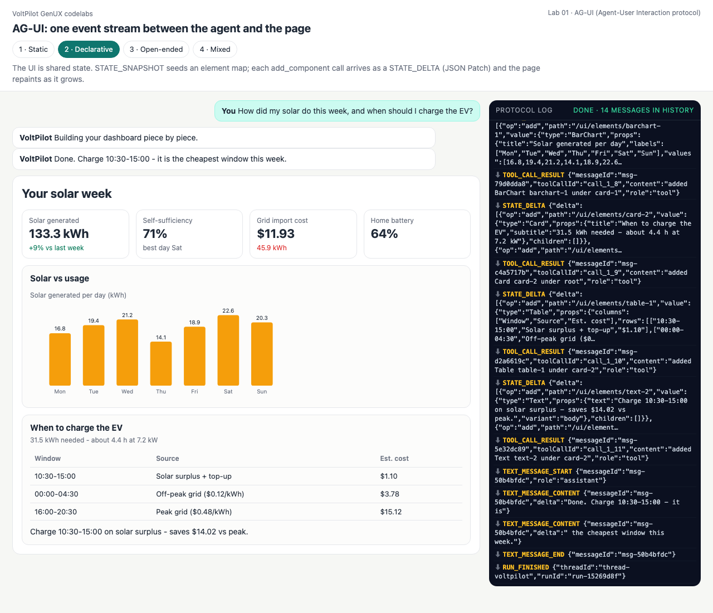
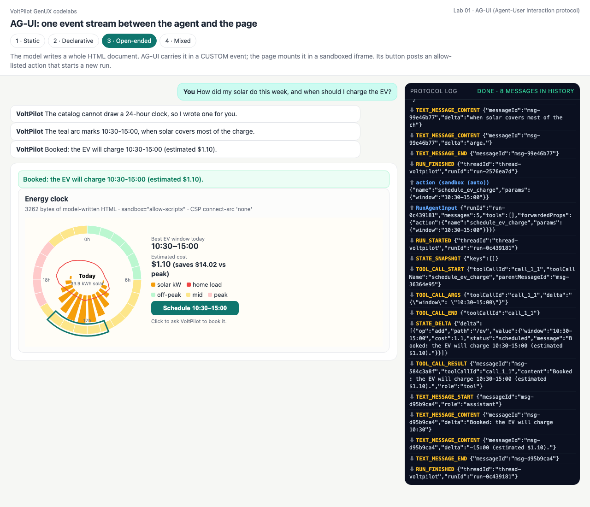
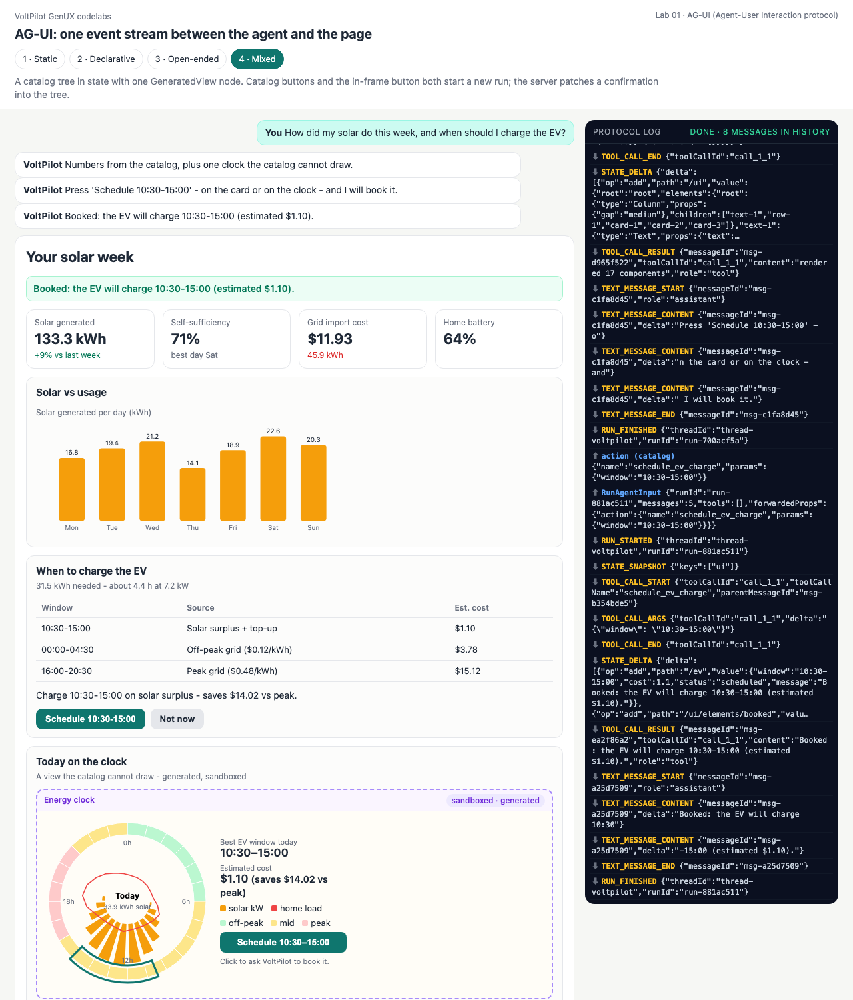

# Lab 01 · AG-UI — one event stream between the agent and the page

**AG-UI** (Agent-User Interaction protocol, [docs.ag-ui.com](https://docs.ag-ui.com)) is a *transport*: the page POSTs a `RunAgentInput` (threadId, runId, state, messages, tools, context, forwardedProps) and reads back a stream of typed JSON events over SSE — `RUN_STARTED`, `TEXT_MESSAGE_START/CONTENT/END`, `TOOL_CALL_START/ARGS/END/RESULT`, `STATE_SNAPSHOT`, `STATE_DELTA` (RFC 6902), `CUSTOM`, `RUN_FINISHED`/`RUN_ERROR`. It does not define a UI format, so each generation mode below picks a different AG-UI feature to carry the UI.

| Mode | Which AG-UI feature carries the UI | Who decides the layout |
|---|---|---|
| 1 · Static | **frontend tools** (`RunAgentInput.tools`) → `TOOL_CALL_*` | the page's prebuilt components |
| 2 · Declarative | **shared state**: `STATE_SNAPSHOT` + `STATE_DELTA` building `state.ui` | the model, inside the catalog |
| 3 · Open-ended | **`CUSTOM`** event `voltpilot.generated_html` → sandboxed iframe | the model, fully |
| 4 · Mixed | `state.ui` with one `GeneratedView` node; clicks start a **new run** | the model, catalog + one region |

No library on either side: [agui.py](agui.py) is the server (~300 lines), [client.js](client.js) the client. The events are checked against the **official `@ag-ui/core` zod schemas** in [conformance/](../../conformance/README.md): 504/504 valid.

```bash
python3 labs/01_ag_ui/static.py        # or declarative / open_ended / mixed   (add --live for Claude)
python3 serve.py                       # http://127.0.0.1:8765/labs/01_ag_ui/?mode=static
```

## The shared server loop

[`run_agent()` — agui.py:138](agui.py#L138) is the whole agent side:

1. emits `RUN_STARTED` and a `STATE_SNAPSHOT` (a *copy* — a later delta must not rewrite an event already sent);
2. streams the model's pieces as `TEXT_MESSAGE_*` and `TOOL_CALL_*` events, closing an open text message before the first tool call;
3. for each **server tool** runs it via [`execute()` (line 203)](agui.py#L203) — unknown tool, bad JSON or an exception all become a `TOOL_CALL_RESULT` the model can read — and publishes its JSON Patch as `STATE_DELTA`;
4. for a **client tool** (one the page declared) stops the run: the page executes it and sends the result on the next run;
5. is bounded by `MAX_TURNS = 6`; any failure ends with `RUN_ERROR`, never a hung stream.

[`check_sequence()` (line 69)](agui.py#L69) enforces what a client relies on (first/last event, balanced message and tool-call brackets); every test run passes through it.

---

## 1 · Static — frontend tools render prebuilt components

[frontend_tools.json](frontend_tools.json) declares `show_energy_summary`, `show_solar_chart`, `show_charge_plan`. The page sends them in `RunAgentInput.tools`; to the model they are just tools.

- [static.py:40](static.py#L40) `SCRIPT` — turn 1 calls the three tools with numbers only; turn 2 is a closing sentence.
- [agui.py:183](agui.py#L183) — the calls are client tools, so the server streams `TOOL_CALL_START/ARGS/END` and finishes the run **without** a `TOOL_CALL_RESULT`.
- [client.js:75](client.js#L75) `TOOL_CALL_END` — the page looks the name up in [components.js](components.js) (developer-written layouts), draws it, and queues a tool result; after `RUN_FINISHED` it starts run 2 with those results.

<!-- output: 01_ag_ui-static from="RUN 1" n=16 -->
```text
RUN 1  POST /api/01_ag_ui/static  ->  SSE
  RUN_STARTED           threadId=thread-voltpilot runId=run-e33e2411
  STATE_SNAPSHOT        snapshot keys=[]
  TEXT_MESSAGE_START    messageId=msg-b781a248 role=assistant
  TEXT_MESSAGE_CONTENT  x2   Here is your week - three panels coming up.
  TEXT_MESSAGE_END      messageId=msg-b781a248
  TOOL_CALL_START       toolCallId=call_1_1 toolCallName=show_energy_summary parentMessageId=msg-b781a248
  TOOL_CALL_ARGS        x4   {"solar_kwh": 133.3, "solar_delta_pct": 9, "self_sufficiency_pct": 71, "import_cost": 11.93, ...
  TOOL_CALL_END         toolCallId=call_1_1
  TOOL_CALL_START       toolCallId=call_1_2 toolCallName=show_solar_chart parentMessageId=msg-b781a248
  TOOL_CALL_ARGS        x4   {"days": ["Mon", "Tue", "Wed", "Thu", "Fri", "Sat", "Sun"], "solar_kwh": [16.8, 19.4, 21.2, 1...
  TOOL_CALL_END         toolCallId=call_1_2
  TOOL_CALL_START       toolCallId=call_1_3 toolCallName=show_charge_plan parentMessageId=msg-b781a248
  TOOL_CALL_ARGS        x11  {"windows": [{"window": "10:30-15:00", "source": "Solar surplus + top-up", "cost": 1.1}, {"wi...
  TOOL_CALL_END         toolCallId=call_1_3
  RUN_FINISHED          threadId=thread-voltpilot runId=run-e33e2411
```
<!-- output: 01_ag_ui-static from="RUN 2" n=8 -->
```text
RUN 2  (tool results sent back)  ->  SSE
  RUN_STARTED           threadId=thread-voltpilot runId=run-7dd41e5d
  STATE_SNAPSHOT        snapshot keys=[]
  TEXT_MESSAGE_START    messageId=msg-b1426605 role=assistant
  TEXT_MESSAGE_CONTENT  x3   Your best charging window is 10:30-15:00: it saves $14.02 versus charging at peak.
  TEXT_MESSAGE_END      messageId=msg-b1426605
  RUN_FINISHED          threadId=thread-voltpilot runId=run-7dd41e5d

```

## 2 · Declarative — the UI tree is shared state

- [declarative.py:33](declarative.py#L33) `INITIAL_STATE` — `state.ui` is an element map `{root, elements}` with one empty Column.
- [declarative.py:54](declarative.py#L54) `add_component()` — validates one element against the catalog and returns **two RFC 6902 ops**: add `/ui/elements/<id>`, append the id to the parent's `children/-`.
- [client.js:87](client.js#L87) — `STATE_DELTA` → `applyPatch` ([common/web/jsonpatch.js:63](../../common/web/jsonpatch.js#L63)) → `flatToTree` → repaint. The dashboard grows while the model is still calling tools.

<!-- output: 01_ag_ui-declarative from="TOOL_CALL_RESULT" n=6 -->
```text
  TOOL_CALL_RESULT      messageId=msg-bf3d3091 toolCallId=call_1_1 content=added Text text-1 under root role=tool
  STATE_DELTA           add /ui/elements/row-1; add /ui/elements/root/children/-
  TOOL_CALL_RESULT      messageId=msg-7653d56b toolCallId=call_1_2 content=added Row row-1 under root role=tool
  STATE_DELTA           add /ui/elements/metric-1; add /ui/elements/row-1/children/-
  TOOL_CALL_RESULT      messageId=msg-469e404c toolCallId=call_1_3 content=added Metric metric-1 under row-1 role=tool
  STATE_DELTA           add /ui/elements/metric-2; add /ui/elements/row-1/children/-
```
<!-- output: 01_ag_ui-declarative from="client replayed" n=6 -->
```text
client replayed 1 snapshot + 11 deltas -> 12 elements; catalog errors: none
what the page draws (terminal renderer, same tree):

YOUR SOLAR WEEK
Solar generated: 133.3 kWh (+9% vs last week)  |  Self-sufficiency: 71% (best day Sat)  |  Grid import cost: $11.93 (45.9 kWh)  |  Home battery: 64%
+-- Solar vs usage -------------------------------------------------------
```

## 3 · Open-ended — generated HTML in a `CUSTOM` event

- [open_ended.py:49](open_ended.py#L49) `render_html()` — runs `policy_check`, then emits `CUSTOM {name: "voltpilot.generated_html", value: {title, html, bytes}}`. AG-UI has no event for markup; `CUSTOM` is its extension point.
- [client.js:88](client.js#L88) — mounts the document with `mountSandbox()`.
- The clock's button posts `{type: "voltpilot:action", ...}`; [client.js:110](client.js#L110) `act()` appends a `[ui-action]` user message and starts a run with `forwardedProps.action`.
- [open_ended.py:79](open_ended.py#L79) `run()` — **checks the action before any model call**; a forged name ends in `RUN_ERROR`.

<!-- output: 01_ag_ui-open_ended from="the user clicks" n=20 -->
```text
the user clicks 'Schedule 10:30-15:00' inside the frame -> postMessage -> page starts RUN 2
  RUN_STARTED           threadId=thread-voltpilot runId=run-d03f26db
  STATE_SNAPSHOT        snapshot keys=[]
  TOOL_CALL_START       toolCallId=call_3_1 toolCallName=schedule_ev_charge parentMessageId=msg-6134a3b9
  TOOL_CALL_ARGS        x1   {"window": "10:30-15:00"}
  TOOL_CALL_END         toolCallId=call_3_1
  STATE_DELTA           add /ev
  TOOL_CALL_RESULT      messageId=msg-9ea8035c toolCallId=call_3_1 content=Booked: the EV will charge 10:30-15:00 (estimated ...
  TEXT_MESSAGE_START    messageId=msg-a2e0fc2a role=assistant
  TEXT_MESSAGE_CONTENT  x2   Booked: the EV will charge 10:30-15:00 (estimated $1.10).
  TEXT_MESSAGE_END      messageId=msg-a2e0fc2a
  RUN_FINISHED          threadId=thread-voltpilot runId=run-d03f26db

a forged message naming a non-allow-listed action is refused before the model runs:
  RUN_STARTED           threadId=thread-voltpilot runId=run-215bff24
  RUN_ERROR             message=action refused: action 'delete_account' is not allowed; a...
```

## 4 · Mixed — catalog tree + one `GeneratedView` + actions

- [mixed.py:48](mixed.py#L48) `render_ui()` — accepts a whole element map, validates catalog **and** content policy for the `GeneratedView`, publishes it as one `STATE_DELTA`.
- [mixed.py:64](mixed.py#L64) `schedule_ev_charge()` — the action's effect is three patch ops: `/ev`, a new `booked` element, and its insertion at `/ui/elements/root/children/1`.
- Catalog buttons and the in-frame button share one path: [client.js:110](client.js#L110) → new run → allow-list check → model calls the tool → `STATE_DELTA`.

<!-- output: 01_ag_ui-mixed from="click on the catalog" n=14 -->
```text
click on the catalog Button 'Schedule 10:30-15:00' -> RUN 2
  RUN_STARTED           threadId=thread-voltpilot runId=run-9d875cb7
  STATE_SNAPSHOT        snapshot keys=['ui']
  TOOL_CALL_START       toolCallId=call_3_1 toolCallName=schedule_ev_charge parentMessageId=msg-72d1e8cb
  TOOL_CALL_ARGS        x1   {"window": "10:30-15:00"}
  TOOL_CALL_END         toolCallId=call_3_1
  STATE_DELTA           add /ev; add /ui/elements/booked; add /ui/elements/root/children/1
  TOOL_CALL_RESULT      messageId=msg-3e060893 toolCallId=call_3_1 content=Booked: the EV will charge 10:30-15:00 (estimated ...
  TEXT_MESSAGE_START    messageId=msg-cf021f9d role=assistant
  TEXT_MESSAGE_CONTENT  x2   Booked: the EV will charge 10:30-15:00 (estimated $1.10).
  TEXT_MESSAGE_END      messageId=msg-cf021f9d
  RUN_FINISHED          threadId=thread-voltpilot runId=run-9d875cb7

after the action: {'text': 'Booked: the EV will charge 10:30-15:00 (estimated $1.10).', 'variant': 'success'}
```

| Static | Declarative | Open-ended (after the click) | Mixed (after the click) |
|---|---|---|---|
|  |  |  |  |

## Quiz

1. **Why does the static run end without a `TOOL_CALL_RESULT`?**
   <details><summary>Answer</summary>The tools were declared by the client, so only the client can execute them. The server ends the run; the page draws, then returns the results as `tool` messages in the next run's input.</details>
2. **Why does `run_agent()` send a deep copy in `STATE_SNAPSHOT`?**
   <details><summary>Answer</summary>The server keeps mutating `state` as deltas apply. Without a copy, an in-memory event list (tests, transcripts) would show a snapshot that already contains later deltas — applying the deltas again would duplicate every element. (This bug was caught by the declarative demo.)</details>
3. **A click inside the sandboxed clock says `transfer_funds`. Where is it stopped?**
   <details><summary>Answer</summary>Twice: `isActionMessage()` in the page drops names outside the allow-list, and the server's `labkit.check_action()` refuses it before any model call (`RUN_ERROR`).</details>
4. **Which AG-UI event would you add to show the model's progress while it builds the tree?**
   <details><summary>Answer</summary>`STEP_STARTED` / `STEP_FINISHED` around each phase, or keep using `TEXT_MESSAGE_*` deltas; both are already validated by `EVENT_FIELDS`.</details>
