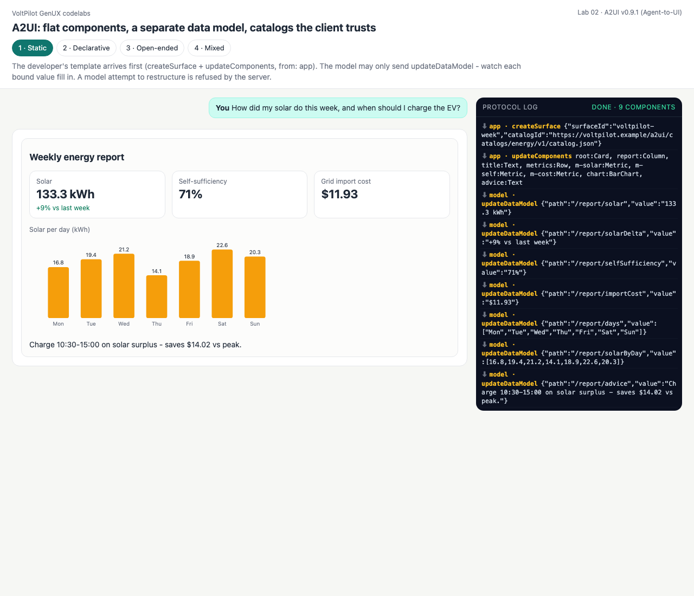
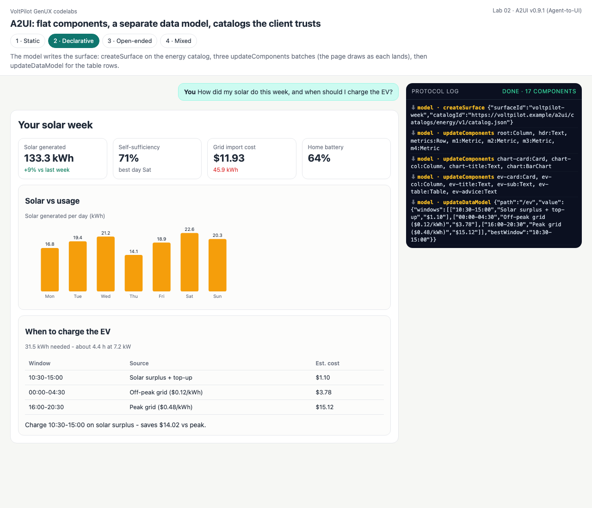
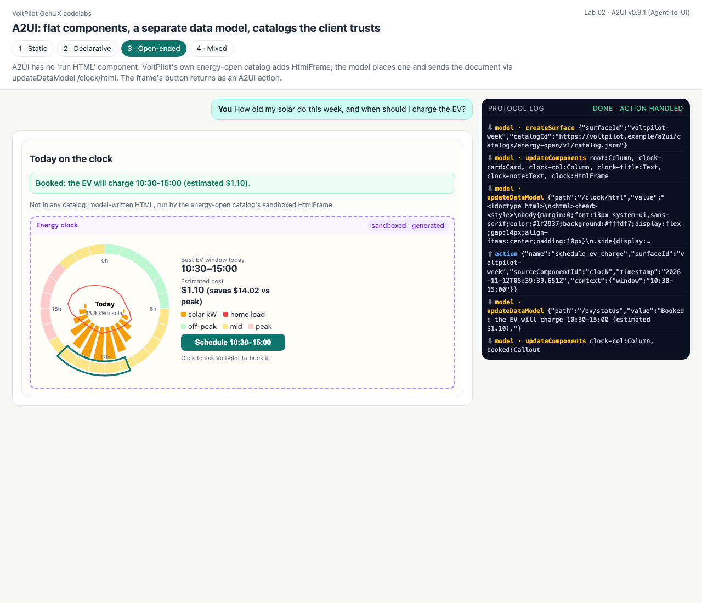
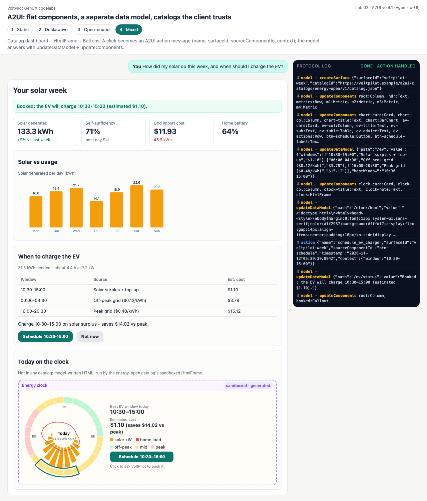

# Lab 02 · A2UI — flat components, a separate data model, catalogs the client trusts

**A2UI v0.9.1** ([a2ui.org](https://a2ui.org)) is a *declarative UI format* built around four envelope messages:

| Message | Carries |
|---|---|
| `createSurface` | a surface id + the **catalogId** its components come from |
| `updateComponents` | a **flat** list of components; each has an `id` and points at children by id (`child` / `children`). Same id = replace |
| `updateDataModel` | a value at a JSON Pointer path; components bind with `{"path": "/report/solar"}` |
| `deleteSurface` | remove the surface |

Structure and data travel separately, so one number can change with one tiny message. And A2UI deliberately has **no "run this HTML" component**: an agent may only name components from a catalog the client already trusts. The sanctioned way to add anything — including a sandboxed HTML frame — is a **custom catalog** with its own `catalogId`, which is exactly how modes 3 and 4 work.

| Mode | Who writes what | Catalog |
|---|---|---|
| 1 · Static | developer: `createSurface` + `updateComponents` (template) · model: **`updateDataModel` only** | energy |
| 2 · Declarative | model: the whole surface, in three component batches, then data | energy (= basic + Metric, BarChart, Table, Callout) |
| 3 · Open-ended | model: an `HtmlFrame` bound to `/clock/html` + the document as data | **energy-open** (+ HtmlFrame) |
| 4 · Mixed | model: dashboard + Buttons + HtmlFrame; clicks return as **A2UI action** messages | energy-open |

```bash
python3 labs/02_a2ui/static.py         # or declarative / open_ended / mixed   (add --live for Claude)
python3 serve.py                       # http://127.0.0.1:8765/labs/02_a2ui/?mode=mixed
```

## Code walkthrough — the protocol

- [a2ui.py:58-71](a2ui.py#L58) — the four builders. [a2ui.py:81](a2ui.py#L81) `validate()` checks version, exactly-one-envelope, catalog membership, required/unknown properties per component, and Button action shape `{event: {name, context}}`.
- [a2ui.py:144](a2ui.py#L144) `Client` — what a renderer keeps per surface: a component map and a data model. `apply()` (line 150) validates against *that surface's* catalog, so the same `HtmlFrame` is legal on energy-open and refused on basic.
- [a2ui.py:198](a2ui.py#L198) `to_canonical()` — resolves `{"path": ...}` bindings ([`bound()`, line 191](a2ui.py#L191)), turns `Card.child` into children, a `Button`'s child Text into its label and its `context` into resolved params, and `HtmlFrame` into the shared `GeneratedView`.
- [a2ui_surfaces.py:192](a2ui_surfaces.py#L192) `relay()` — the server side: parse the model's JSONL line by line ([`jsonl_messages()`, a2ui.py:243](a2ui.py#L243)), enforce the **mode policy** (`allowed=`), apply to a server-side mirror so unknown surfaces/components are refused *before* the page sees them.
- Browser twin: [surface.js](surface.js) `SurfaceStore` + `toCanonical` (node-tested), [client.js](client.js) draws after every message.

---

## 1 · Static — the developer ships the surface, the model fills data

[a2ui_surfaces.py:33](a2ui_surfaces.py#L33) `TEMPLATE` is the developer's layout; every value is a binding. [static.py:33](static.py#L33) `run()` sends the app's two messages, then relays the model with `allowed={"updateDataModel"}`.

<!-- output: 02_a2ui-static from="[app  ]" n=12 -->
```text
  [app  ] createSurface     surface=voltpilot-week catalog=energy
  [app  ] updateComponents  9 components  root:Card, report:Column, title:Text, metrics:Row, m-solar:Metric, m-self:Met...
  [model] updateDataModel   /report/solar = 133.3 kWh
  [model] updateDataModel   /report/solarDelta = +9% vs last week
  [model] updateDataModel   /report/selfSufficiency = 71%
  [model] updateDataModel   /report/importCost = $11.93
  [model] updateDataModel   /report/days = ["Mon","Tue","Wed","Thu","Fri","Sat","Sun"]
  [model] updateDataModel   /report/solarByDay = [16.8,19.4,21.2,14.1,18.9,22.6,20.3]
  [model] updateDataModel   /report/advice = Charge 10:30-15:00 on solar surplus - saves $14.02 vs peak.

client state: 9 components, data paths ['report']; missing refs: none
+-------------------------------------------------------------------------
```
<!-- output: 02_a2ui-static from="policy check" n=2 -->
```text
policy check - the model tries to restructure the surface in static mode:
  [model] REJECTED  updateComponents refused: in this mode the model may only send ['updateDataModel']
```

## 2 · Declarative — the model writes the surface

[a2ui_surfaces.py:121](a2ui_surfaces.py#L121) `declarative_reply()` — create, then three `updateComponents` batches (header+metrics, chart card, EV card) so the page paints progressively, then `updateDataModel /ev` for the table rows (`"rows": {"path": "/ev/windows"}`).

<!-- output: 02_a2ui-declarative from="[model]" n=6 -->
```text
  [model] createSurface     surface=voltpilot-week catalog=energy
  [model] updateComponents  7 components  root:Column, hdr:Text, metrics:Row, m1:Metric, m2:Metric, m3:Metric, m4:Metric
  [model] updateComponents  4 components  chart-card:Card, chart-col:Column, chart-title:Text, chart:BarChart
  [model] updateComponents  6 components  ev-card:Card, ev-col:Column, ev-title:Text, ev-sub:Text, ev-table:Table, ev-a...
  [model] updateDataModel   /ev = {"windows":[["10:30-15:00","Solar surplus + top-up","$1.10"],["00:00-...

```
<!-- output: 02_a2ui-declarative from="catalog check" n=2 -->
```text
catalog check - a component the energy catalog does not have:
  [model] REJECTED  updateComponents/components/0 (pie): component 'PieChart' is not in catalog https://voltpilot.example/a2ui/catalogs/energy/v1/catalog.json
```

## 3 · Open-ended — `HtmlFrame` from a custom catalog

[a2ui_surfaces.py:107](a2ui_surfaces.py#L107) `clock_card()` places `{"component": "HtmlFrame", "html": {"path": "/clock/html"}}`; the document arrives through `updateDataModel`. [open_ended.py:42](open_ended.py#L42) `checked()` adds the content policy on top of the catalog check. The frame's button comes back through [`handle_action()`](a2ui_surfaces.py#L174).

<!-- output: 02_a2ui-open_ended from="[model]" n=3 -->
```text
  [model] createSurface     surface=voltpilot-week catalog=energy-open
  [model] updateComponents  6 components  root:Column, clock-card:Card, clock-col:Column, clock-title:Text, clock-note:...
  [model] updateDataModel   /clock/html = <!doctype html>\n<html><head><style>\nbody{margin:0;font:13px system-...
```
<!-- output: 02_a2ui-open_ended from="/clock/html:" n=4 -->
```text
/clock/html: 3262 bytes, policy problems: none

the same HtmlFrame on the BASIC catalog is refused - it is not a basic component:
  updateComponents/components/0 (root): component 'HtmlFrame' is not in catalog https://a2ui.org/specification/v0_9_1/catalogs/basic/catalog.json
```

## 4 · Mixed — catalog + HtmlFrame + the action round trip

A Button's `action.event.context` binds to the data model, so a click sends `{"window": <value at /ev/bestWindow>}`. The page builds the A2UI action message ([surface.js:96](surface.js#L96)) and POSTs it to `/api/02_a2ui/mixed/action`; [a2ui_surfaces.py:174](a2ui_surfaces.py#L174) checks the allow-list, gives the action to the model as a user turn, and relays its answer — one data update and one structural update that inserts a `Callout` bound to `/ev/status` ([action_reply(), line 161](a2ui_surfaces.py#L161)).

<!-- output: 02_a2ui-mixed from="click -> client sends" n=10 -->
```text
click -> client sends: {'version': 'v0.9.1', 'action': {'name': 'schedule_ev_charge', 'surfaceId': 'voltpilot-week', 'sourceComponentId': 'btn-schedule', 'timestamp': '2026-11-11T18:00:00Z', 'context': {'window': '10:30-15:00'}}}
  [model] updateDataModel   /ev/status = Booked: the EV will charge 10:30-15:00 (estimated $1.10).
  [model] updateComponents  2 components  root:Column, booked:Callout

after the action, /ev/status = 'Booked: the EV will charge 10:30-15:00 (estimated $1.10).'
root children: ['hdr', 'booked', 'metrics', 'chart-card', 'ev-card', 'clock-card']

a forged action is refused before the model sees it:
  [app] action refused: action 'transfer_funds' is not allowed; allowed: ['dismiss', 'schedule_ev_charge']
```

| Static | Declarative | Open-ended (after the click) | Mixed (after the click) |
|---|---|---|---|
|  |  |  |  |

## Quiz

1. **Why is the A2UI component list flat instead of nested?**
   <details><summary>Answer</summary>Components refer to children by id, so each message can be applied on arrival, a single component can be replaced by id, and a renderer can draw a surface whose children have not arrived yet (they show as placeholders).</details>
2. **In static mode, what stops the model from changing the layout?**
   <details><summary>Answer</summary>The relay's mode policy: only `updateDataModel` is allowed, so `updateComponents` from the model is refused before it reaches the page.</details>
3. **Why put the clock's HTML in the data model rather than as a literal prop?**
   <details><summary>Answer</summary>Structure and content stay separate: the HtmlFrame component is small and validated like any other; the large, untrusted document is one data update that gets its own policy check and can be replaced without touching the layout.</details>
4. **Could the same surface be delivered over AG-UI instead of our SSE frames?**
   <details><summary>Answer</summary>Yes — format and transport are separate choices. Each A2UI message would ride in an AG-UI `CUSTOM` event; nothing in `a2ui.py` would change.</details>
