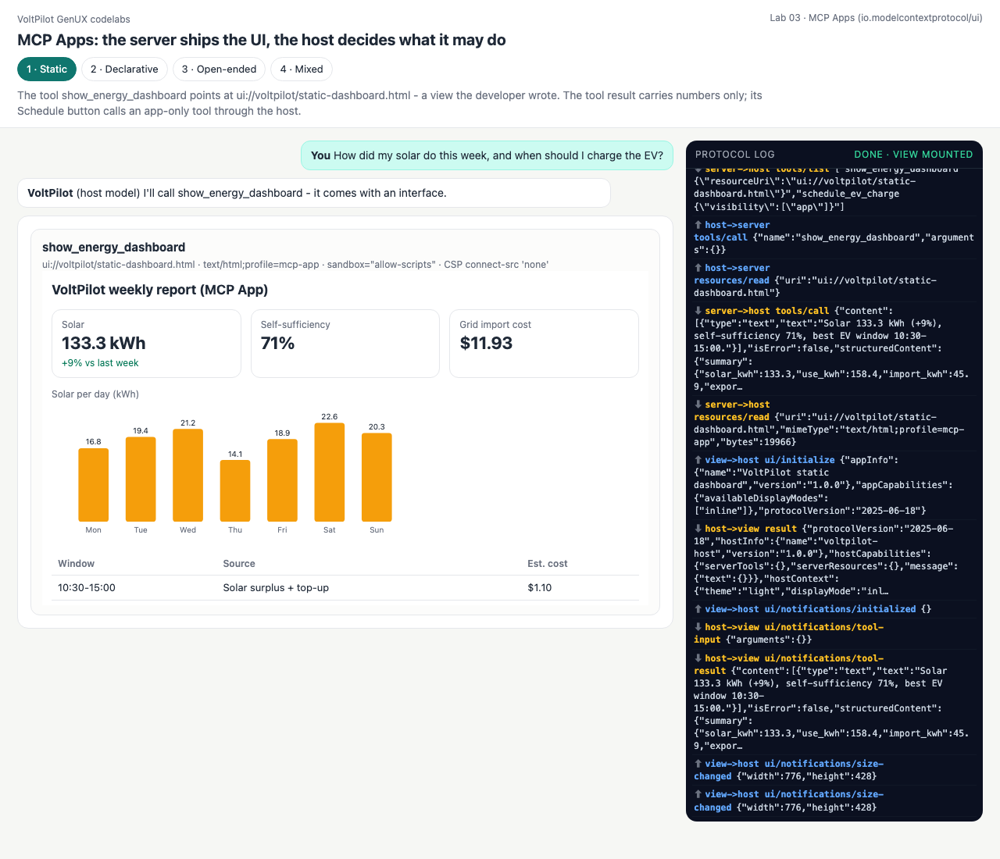
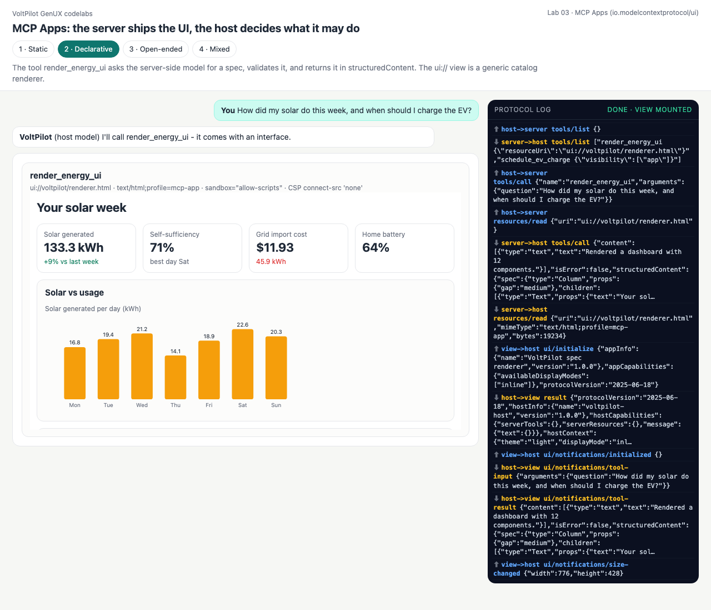
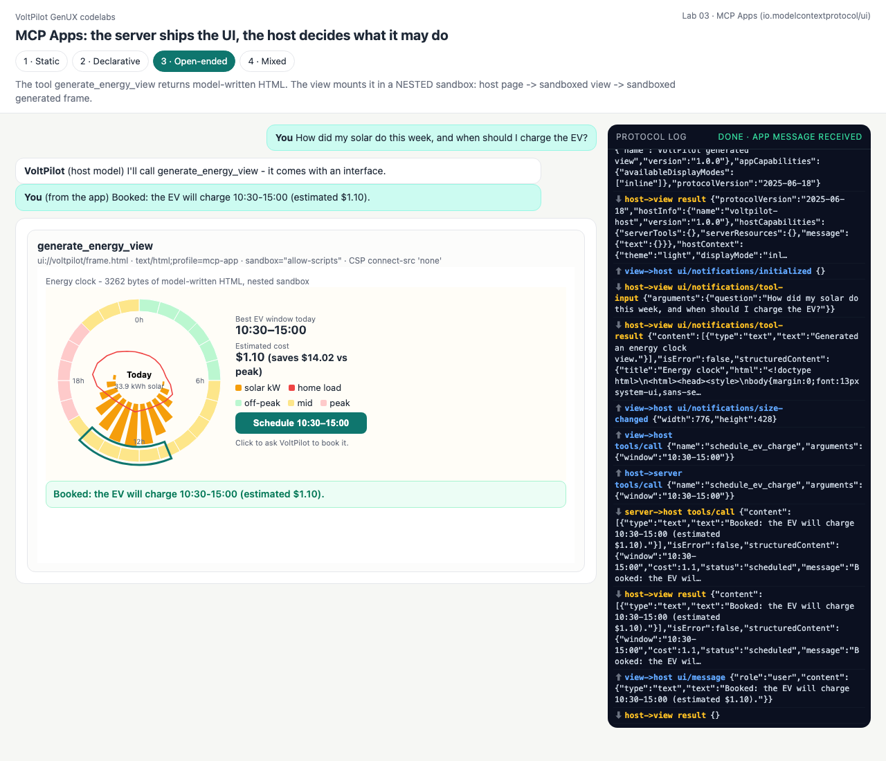
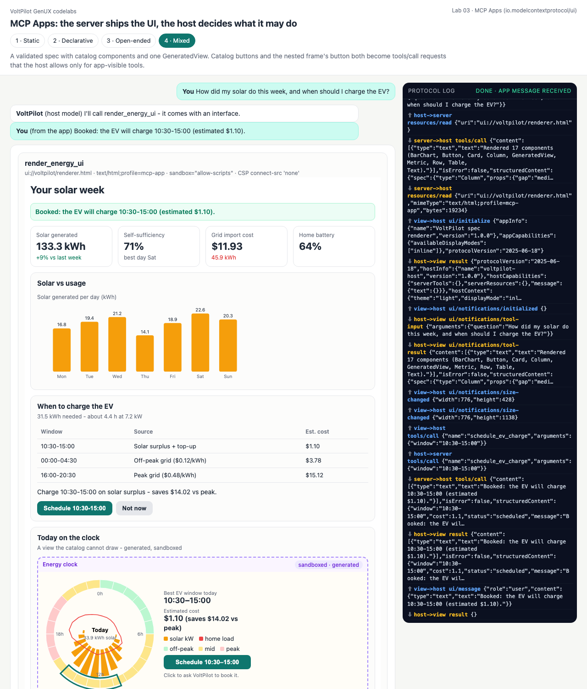

# Lab 03 · MCP Apps — the server ships the UI, the host decides what it may do

**MCP Apps** (the `io.modelcontextprotocol/ui` extension, SEP-1865, [overview](https://modelcontextprotocol.io/extensions/apps/overview)) adds an interface to an MCP tool:

1. the tool definition carries `_meta.ui.resourceUri = "ui://…"`;
2. `resources/read` on that URI returns HTML with mimeType **`text/html;profile=mcp-app`**;
3. the **host** (Claude Desktop, Goose, or our [client.js](client.js)) mounts it in a sandboxed iframe with a restrictive CSP and talks to it with **JSON-RPC 2.0 over `postMessage`**: `ui/initialize` → `ui/notifications/initialized` → `ui/notifications/tool-input` → `ui/notifications/tool-result`; the view may then call `tools/call` — but only for tools whose `_meta.ui.visibility` includes `"app"` — and `ui/message` to speak into the chat.

```
browser page = HOST ── JSON-RPC/HTTP ──► MCP server (Python, stdlib)      also over stdio for desktop hosts
   │ iframe sandbox="allow-scripts" + CSP
   └─► ui:// VIEW ── postMessage JSON-RPC ──► host bridge (allow-list by visibility)
          └─► (modes 3-4) nested sandboxed iframe with model-written HTML
```

| Mode | Tool | ui:// view | Where the model is |
|---|---|---|---|
| 1 · Static | `show_energy_dashboard` → numbers in `structuredContent` | hand-written dashboard | only the host's model (picks the tool) |
| 2 · Declarative | `render_energy_ui` → validated `spec` | generic catalog renderer | also inside the server: writes the spec |
| 3 · Open-ended | `generate_energy_view` → `html` | frame view, **nested sandbox** | inside the server: writes HTML |
| 4 · Mixed | `render_energy_ui` → spec with one `GeneratedView` + Buttons | renderer + nested sandbox | inside the server |

Every mode also exposes `schedule_ev_charge` with **`visibility: ["app"]`** — callable from the view through the host, invisible to the model.

```bash
python3 labs/03_mcp_apps/mixed.py                                   # in-process host demo
python3 serve.py                                                    # http://127.0.0.1:8765/labs/03_mcp_apps/?mode=mixed
python3 labs/03_mcp_apps/mcp_server.py --stdio --mode mixed         # the stdio transport desktop hosts launch
```

**Verified with the official SDK:** [conformance/mcp.mjs](../../conformance/mcp.mjs) connects `@modelcontextprotocol/sdk`'s `Client` + `StdioClientTransport` to this Python server and runs initialize → tools/list → tools/call → resources/read for all four modes (4/4 OK, [output](../../docs/outputs/conformance.txt)).

## Code walkthrough

**Server** — [mcp_server.py](mcp_server.py)
- [line 84](mcp_server.py#L84) `MCPServer.handle()` / [`dispatch()` (107)](mcp_server.py#L107) — JSON-RPC 2.0: `initialize` (advertises the UI extension and mime type), `ping`, `tools/list`, `tools/call` (a failing tool is `isError: true`, not a protocol error), `resources/list`, `resources/read`. Notifications get no reply.
- [line 139](mcp_server.py#L139) `ui_tool()` — puts `resourceUri` and `visibility` under `_meta.ui`.
- [line 56](mcp_server.py#L56) `bundle()` — a view runs under `connect-src 'none'`, so it cannot fetch its scripts: the shared renderer, sandbox helper and view bridge are **inlined** into the resource (imports dropped, `export` stripped, `</script` escaped so the inline script stays intact).
- [line 201](mcp_server.py#L201) `serve_stdio()` — newline-delimited JSON-RPC on stdin/stdout.

**Host** — [client.js](client.js) + [bridge.js](bridge.js)
- [client.js:23](client.js#L23) `rpc()` — an MCP client over HTTP; [line 47](client.js#L47) mounts the view with `sandbox="allow-scripts"` and [line 51](client.js#L51) `withCsp(html, cspFor(_meta.ui))`.
- [bridge.js:23](bridge.js#L23) `cspFor()` — the restrictive default; declared domains are added only if they cannot smuggle a directive (`;`, spaces, quotes).
- [bridge.js:47](bridge.js#L47) `HostBridge` — DOM-free (node-tested): queues notifications until `initialized`, answers `ui/initialize`, and refuses `tools/call` unless [`viewMayCall()` (line 42)](bridge.js#L42).

**View side** — [views/app_bridge.js](views/app_bridge.js) only reads messages whose `source` is `window.parent`, so a nested generated frame cannot impersonate the host.

---

## 1 · Static — developer-written view, data-only result

[static.py:32](static.py#L32): `content` is text for the model; `structuredContent` is data for the view. [views/static.html](views/static.html) lays it out itself.

<!-- output: 03_mcp_apps-static from="tool show_energy_dashboard" n=22 -->
```text
  tool show_energy_dashboard  _meta.ui={'resourceUri': 'ui://voltpilot/static-dashboard.html'}
  tool schedule_ev_charge     _meta.ui={'visibility': ['app']}

host model picks show_energy_dashboard (model may call: True)
  host -> server  tools/call      <- {"content":[{"type":"text","text":"Solar 133.3 kWh (+9%), self-sufficiency 71%, best EV window 1...
  content (for the model): Solar 133.3 kWh (+9%), self-sufficiency 71%, best EV window 10:30-15:00.
  structuredContent keys (for the view): ['summary', 'week', 'windows']
  host -> server  resources/read  <- {"contents":[{"uri":"ui://voltpilot/static-dashboard.html","mimeType":"text/html;profile=mcp-app...

view ui://voltpilot/static-dashboard.html  mimeType=text/html;profile=mcp-app  19966 bytes (scripts inlined)
host CSP: default-src 'none'; script-src 'self' 'unsafe-inline'; style-src 'self' 'unsafe-inline'; img-src 'self' data:; font-src 'self'; connect-src 'none'; frame-src 'none'; object-src 'none'; base-uri 'self'

the view's Schedule button -> tools/call schedule_ev_charge (visibility ['app'])
  view may call: True   model may call: False
  host -> server  tools/call      <- {"content":[{"type":"text","text":"Booked: the EV will charge 10:30-15:00 (estimated $1.10)."}],...
  -> Booked: the EV will charge 10:30-15:00 (estimated $1.10).
  host -> server  tools/call      <- {"content":[{"type":"text","text":"error: unknown charge window '03:00-04:00'; expected one of [...
  bad window -> isError=True: error: unknown charge window '03:00-04:00'; expected one of ['00:00-04:30', '10:30-15:00',

user prompt in the host chat: How did my solar do this week, and when should I charge the EV?
```

## 2 · Declarative — server-side model, validated spec, generic view

[mcp_voltpilot.py:62](mcp_voltpilot.py#L62) `generate_spec()` asks the model for a component tree and validates it **before it leaves the server**. [views/renderer.html](views/renderer.html) knows only the catalog.

<!-- output: 03_mcp_apps-declarative from="spec:" n=6 -->
```text
spec: 12 components, catalog errors: none
  host -> server  resources/read  <- {"contents":[{"uri":"ui://voltpilot/renderer.html","mimeType":"text/html;profile=mcp-app","text"...
view ui://voltpilot/renderer.html (19234 bytes) - a generic renderer; what it will draw:

YOUR SOLAR WEEK
Solar generated: 133.3 kWh (+9% vs last week)  |  Self-sufficiency: 71% (best day Sat)  |  Grid import cost: $11.93 (45.9 kWh)  |  Home battery: 64%
```

## 3 · Open-ended — generated HTML, nested sandbox

[open_ended.py:40](open_ended.py#L40) lints the model's document; [views/frame.html](views/frame.html) mounts it one level deeper. A button in it passes three checks: the view's message-shape/allow-list, the host's visibility rule, the server's argument check.

<!-- output: 03_mcp_apps-open_ended from="structuredContent:" n=8 -->
```text
structuredContent: title='Energy clock', 3262 bytes, policy problems: none
  host -> server  resources/read  <- {"contents":[{"uri":"ui://voltpilot/frame.html","mimeType":"text/html;profile=mcp-app","text":"<...
view ui://voltpilot/frame.html mounts it with: <iframe sandbox="allow-scripts"> + CSP default-src 'none'; script-src 'unsafe-inline'; styl...

a document that tries to phone home is refused at the server:
  isError=True: refused by content policy: opens a network connection, touches browser storage
```

## 4 · Mixed — catalog spec + nested GeneratedView + app-only tool

<!-- output: 03_mcp_apps-mixed from="click (catalog" n=5 -->
```text
click (catalog Button or nested frame) -> view -> host: may the view call schedule_ev_charge? True
  host -> server  tools/call      <- {"content":[{"type":"text","text":"Booked: the EV will charge 10:30-15:00 (estimated $1.10)."}],...
  -> Booked: the EV will charge 10:30-15:00 (estimated $1.10).
and may the host's MODEL call it directly? False (visibility ['app'])
```

The screenshot below is the full loop in the browser: host → server → view → nested frame → `tools/call` → host → server → `ui/message` back into the host chat.

| Static | Declarative | Open-ended (after the call) | Mixed (after the call) |
|---|---|---|---|
|  |  |  |  |

### Using it from a real host (not verified here)
Desktop hosts launch MCP servers over stdio. A Claude Desktop entry would look like:
```json
{ "mcpServers": { "voltpilot": { "command": "python3", "args": ["/ABSOLUTE/PATH/labs/03_mcp_apps/mcp_server.py", "--stdio", "--mode", "mixed"] } } }
```
Whether a given host renders the `ui://` resource depends on its MCP Apps support; this repo verifies the server with the official SDK client and the bridge with its own host page, not inside Claude Desktop or Goose.

## Quiz

1. **The view and the model can both "call tools". What decides which tools each may call?**
   <details><summary>Answer</summary>`_meta.ui.visibility`. `schedule_ev_charge` is `["app"]`: the host's bridge lets the view call it and the host never offers it to the model. Tools without the field default to both.</details>
2. **Why are the view's scripts inlined instead of loaded with `<script src>`?**
   <details><summary>Answer</summary>The host's CSP gives the view `connect-src 'none'` and no script origins; a sandboxed srcdoc frame has an opaque origin. The resource must be self-contained.</details>
3. **Why does `frame-src 'none'` not block the nested generated frame?**
   <details><summary>Answer</summary>A `srcdoc` frame has no URL to match against `frame-src`; it inherits the parent's policy and gets its own stricter CSP on top.</details>
4. **`tools/call` for a bad charge window returns HTTP 200 with `isError: true`. Why not a JSON-RPC error?**
   <details><summary>Answer</summary>The protocol call succeeded; the *tool* failed. MCP reports tool failures as results so the model (or view) can read and recover.</details>
