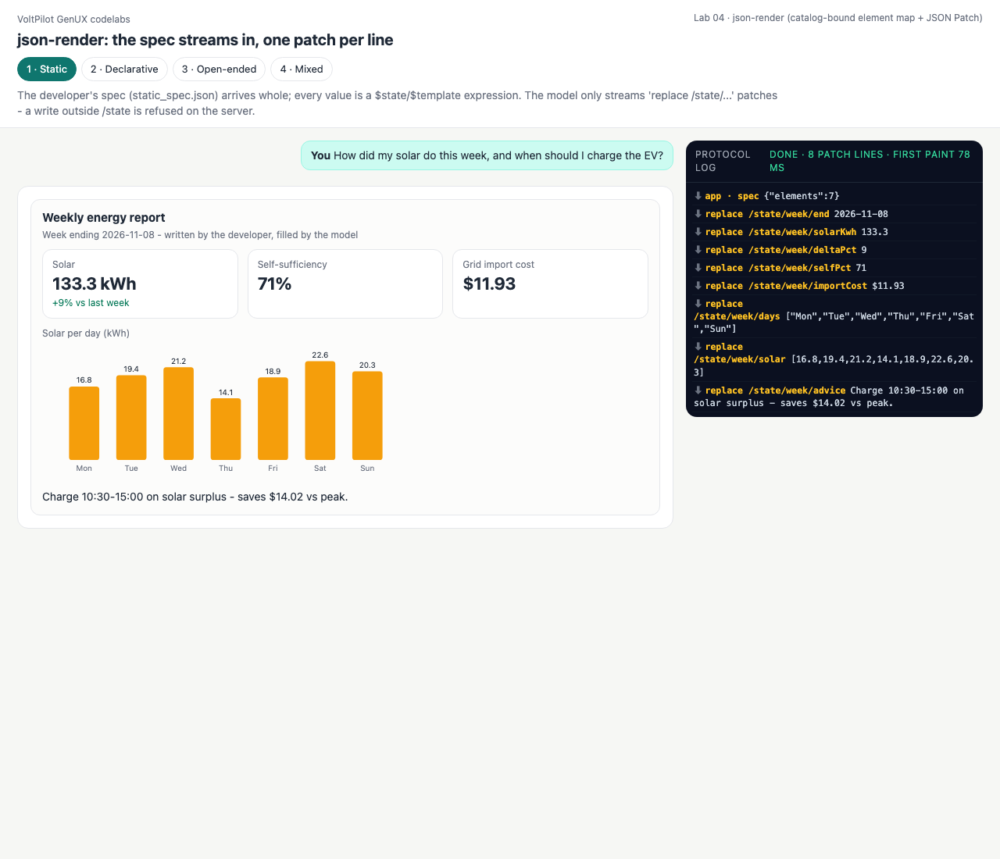
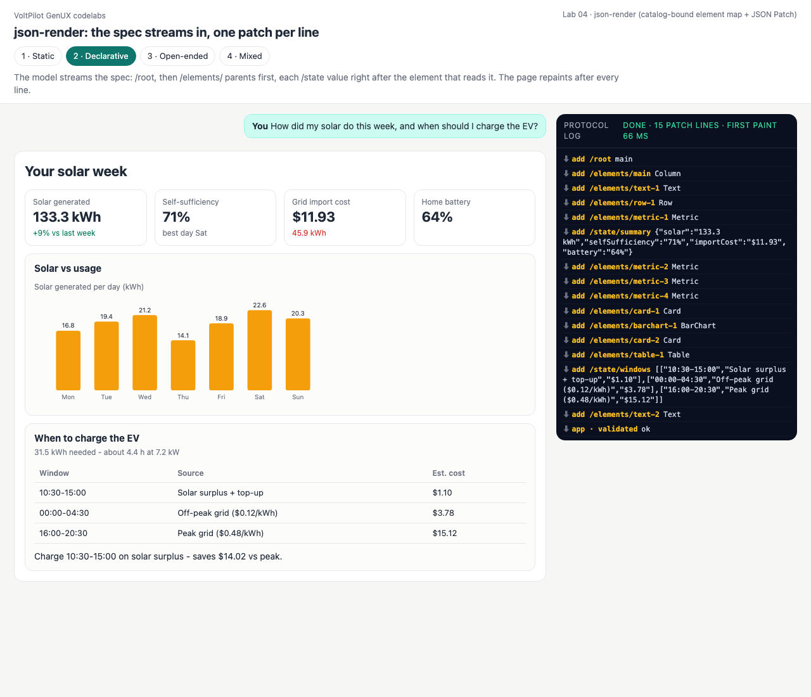
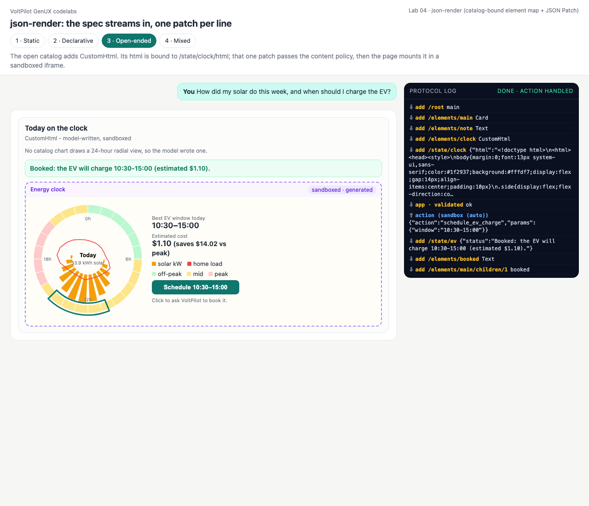
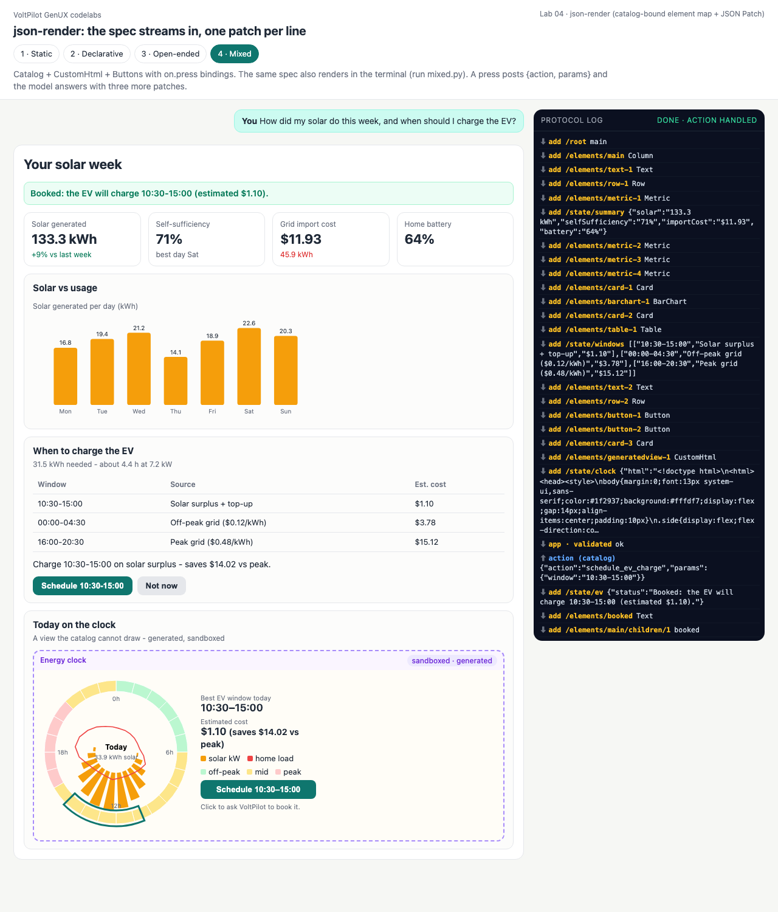

# Lab 04 · json-render — the spec streams in, one patch per line

**json-render** (Vercel Labs) describes a UI as a flat **element map** plus a **state model**, constrained by a catalog:

```json
{ "root": "main",
  "elements": { "main": { "type": "Card", "props": { "title": "..." }, "children": ["m1", "go"] },
                "m1":   { "type": "Metric", "props": { "label": "Solar", "value": { "$state": "/summary/solar" } } },
                "go":   { "type": "Button", "props": { "label": "Book" },
                          "on": { "press": { "action": "schedule_ev_charge", "params": { "window": "10:30-15:00" } } } } },
  "state": { "summary": { "solar": "133.3 kWh" } } }
```

The model does not write that in one piece: it streams **RFC 6902 JSON Patch** lines — `/root` first, then `/elements/<id>` parents-first, each `/state` value right after the first element that reads it. A flat map is what makes this work: every line is a complete, valid edit, while a nested tree is not valid JSON until its last bracket. Expressions: `{"$state": "/path"}`, `{"$template": "… ${/path} …"}`; events: an element's `on` field.

| Mode | What the model streams | Gate |
|---|---|---|
| 1 · Static | `replace /state/...` only — the developer's [static_spec.json](static_spec.json) arrives whole first | `SpecStream(writable=["/state"])` |
| 2 · Declarative | the whole spec as patches | catalog validation at the end |
| 3 · Open-ended | a spec with a `CustomHtml` whose `html` is `{"$state": "/clock/html"}` | content policy on that state patch |
| 4 · Mixed | catalog + `CustomHtml` + Buttons with `on.press`; **two renderers** (web + terminal) | both of the above + action allow-list |

```bash
python3 labs/04_json_render/mixed.py       # prints the patch stream AND the terminal rendering
python3 serve.py                           # http://127.0.0.1:8765/labs/04_json_render/?mode=declarative
```

**Verified with the official package:** [conformance/formats.mjs](../../conformance/formats.mjs) runs `@json-render/core@0.20.0`'s `validateSpec()` on all four final specs (valid, 0 errors) and resolves every element's props with its `resolveElementProps()` — 0 mismatches against our resolver.

## Code walkthrough — [jsonrender.py](jsonrender.py)

- [line 42](jsonrender.py#L42) `resolve_value()` — `$state` and `$template` (recursively through objects/arrays).
- [line 54](jsonrender.py#L54) `to_canonical()` — spec → canonical tree: resolves props, turns `on.press` into the Button's action + params, `CustomHtml` into `GeneratedView`, honours `visible`; children that have not streamed yet are skipped.
- [line 90](jsonrender.py#L90) `SpecStream` — applies one patch at a time; `writable=` restricts which paths a stream may touch (static mode).
- [line 111](jsonrender.py#L111) `patch_lines()` — JSONL out of a token stream: each line is yielded the moment its newline arrives.
- [line 136](jsonrender.py#L136) `spec_to_patches()` — how the scripted model orders its lines (state right after its first reader), mirroring json-render's own prompt.
- [jr_lab.py:29](jr_lab.py#L29) `relay()` — server gate: parse, policy-check `/state/clock` documents, apply, forward.
- Browser: [spec-stream.js](spec-stream.js) (node-tested twin) and [client.js](client.js), which also measures time-to-first-paint.

---

## 1 · Static
<!-- output: 04_json_render-static from="[app  ]" n=10 -->
```text
  [app  ] spec (app-shipped, 7 elements)
  [model] replace /state/week/end              2026-11-08
  [model] replace /state/week/solarKwh         133.3
  [model] replace /state/week/deltaPct         9
  [model] replace /state/week/selfPct          71
  [model] replace /state/week/importCost       $11.93
  [model] replace /state/week/days             ["Mon","Tue","Wed","Thu","Fri","Sat","Sun"]
  [model] replace /state/week/solar            [16.8,19.4,21.2,14.1,18.9,22.6,20.3]
  [model] replace /state/week/advice           Charge 10:30-15:00 on solar surplus - saves $14.02 vs peak.

```
<!-- output: 04_json_render-static from="the model tries" n=2 -->
```text
the model tries to add an element in static mode:
  add /elements/ad refused: this stream may only write ['/state']
```

## 2 · Declarative
<!-- output: 04_json_render-declarative from="[model] add     /root" n=12 -->
```text
  [model] add     /root                        main
  [model] add     /elements/main               Column
  [model] add     /elements/text-1             Text
  [model] add     /elements/row-1              Row
  [model] add     /elements/metric-1           Metric
  [model] add     /state/summary               {"solar":"133.3 kWh","selfSufficiency":"71%","importCost":"$11.93",...
  [model] add     /elements/metric-2           Metric
  [model] add     /elements/metric-3           Metric
  [model] add     /elements/metric-4           Metric
  [model] add     /elements/card-1             Card
  [model] add     /elements/barchart-1         BarChart
  [model] add     /elements/card-2             Card
```
<!-- output: 04_json_render-declarative from="patch lines;" n=3 -->
```text
15 patch lines; the page can draw after line 3 (root + first element)

validation: ok
```

## 3 · Open-ended
<!-- output: 04_json_render-open_ended from="[model]" n=5 -->
```text
  [model] add     /root                        main
  [model] add     /elements/main               Card
  [model] add     /elements/note               Text
  [model] add     /elements/clock              CustomHtml
  [model] add     /state/clock                 {"html":"<!doctype html>\n<html><head><style>\nbody{margin:0;font:1...
```
<!-- output: 04_json_render-open_ended from="the frame's button" n=8 -->
```text
the frame's button -> POST .../open_ended/action {action: schedule_ev_charge}
  [model] add     /state/ev                    {"status":"Booked: the EV will charge 10:30-15:00 (estimated $1.10)."}
  [model] add     /elements/booked             Text
  [model] add     /elements/main/children/1    booked

a document that reaches for the network never reaches the page:
  [model] REFUSED CustomHtml document refused: loads a remote URL
```

## 4 · Mixed — one spec, two renderers
<!-- output: 04_json_render-mixed from="terminal renderer" n=26 -->
```text
terminal renderer (same spec the page draws):
YOUR SOLAR WEEK
Solar generated: 133.3 kWh (+9% vs last week)  |  Self-sufficiency: 71% (best day Sat)  |  Grid import cost: $11.93 (45.9 kWh)  |  Home battery: 64%
+-- Solar vs usage -------------------------------------------------------
  Solar generated per day
     Mon ######################         16.8 kWh
     Tue ##########################     19.4 kWh
     Wed ############################   21.2 kWh
     Thu ###################            14.1 kWh
     Fri #########################      18.9 kWh
     Sat ############################## 22.6 kWh
     Sun ###########################    20.3 kWh
+-------------------------------------------------------------------------
+-- When to charge the EV - 31.5 kWh needed - about 4.4 h at 7.2 kW ------
  Window       Source                     Est. cost
  -----------  -------------------------  ---------
  10:30-15:00  Solar surplus + top-up     $1.10
  00:00-04:30  Off-peak grid ($0.12/kWh)  $3.78
  16:00-20:30  Peak grid ($0.48/kWh)      $15.12
  Charge 10:30-15:00 on solar surplus - saves $14.02 vs peak.
  [ Schedule 10:30-15:00 ] -> schedule_ev_charge  |  [ Not now ] -> dismiss
+-------------------------------------------------------------------------
+-- Today on the clock - A view the catalog cannot draw - generated, sandboxed --
  [generated view: Energy clock - 3262 bytes of HTML; open the web surface to see it]
+-------------------------------------------------------------------------

```
<!-- output: 04_json_render-mixed from="press 'Schedule" n=9 -->
```text
press 'Schedule 10:30-15:00' -> POST /api/04_json_render/mixed/action
  [model] add     /state/ev                    {"status":"Booked: the EV will charge 10:30-15:00 (estimated $1.10)."}
  [model] add     /elements/booked             Text
  [model] add     /elements/main/children/1    booked

terminal renderer after the action (first lines):
YOUR SOLAR WEEK
Booked: the EV will charge 10:30-15:00 (estimated $1.10).
Solar generated: 133.3 kWh (+9% vs last week)  |  Self-sufficiency: 71% (best day Sat)  |  Grid import cost: $11.93 (45.9 kWh)  |  Home battery: 64%
```

| Static | Declarative | Open-ended (after the click) | Mixed (after the click) |
|---|---|---|---|
|  |  |  |  |

## Quiz

1. **Why does json-render stream a flat element map instead of a nested tree?**
   <details><summary>Answer</summary>Each patch line is a complete edit that can be applied and drawn immediately; a nested JSON tree cannot be parsed until it is closed (or needs a partial-JSON parser).</details>
2. **Why emit a `/state` key right after the first element that reads it?**
   <details><summary>Answer</summary>So bound values appear as soon as their element does, instead of the whole UI showing blanks until the state arrives at the end.</details>
3. **What makes the terminal renderer possible?**
   <details><summary>Answer</summary>The spec names components, not pixels. Any target that maps the catalog's types can draw it; `CustomHtml` degrades to a placeholder where HTML cannot run.</details>
