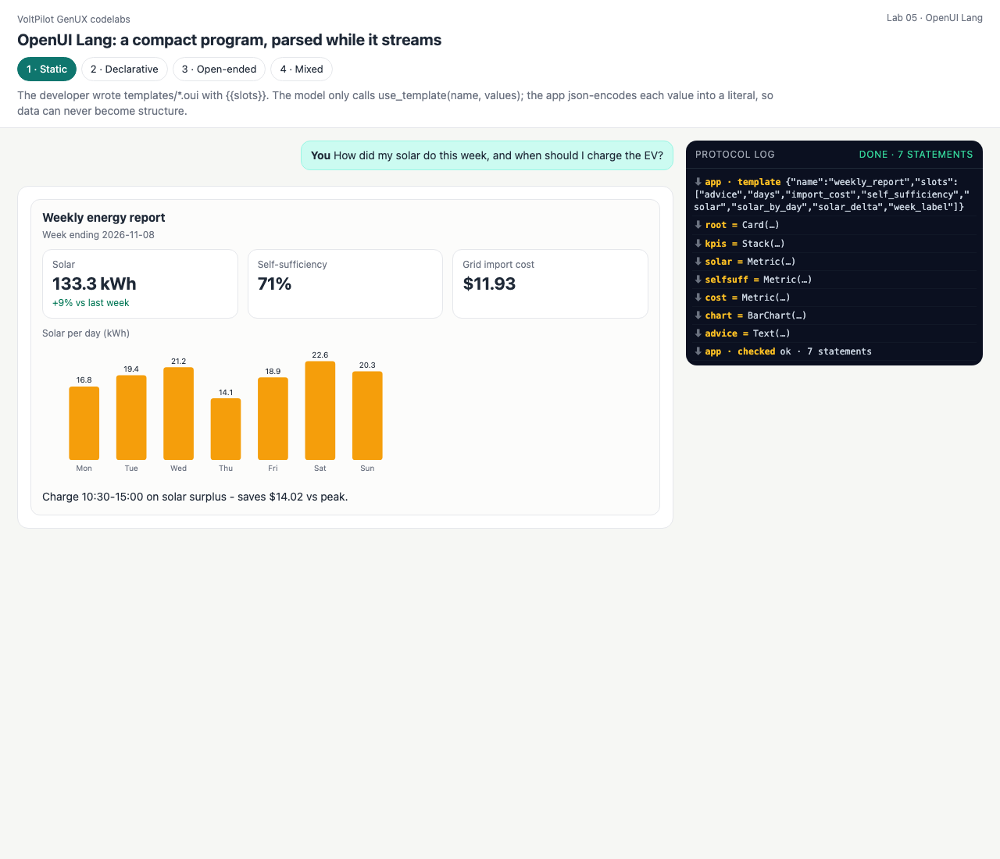
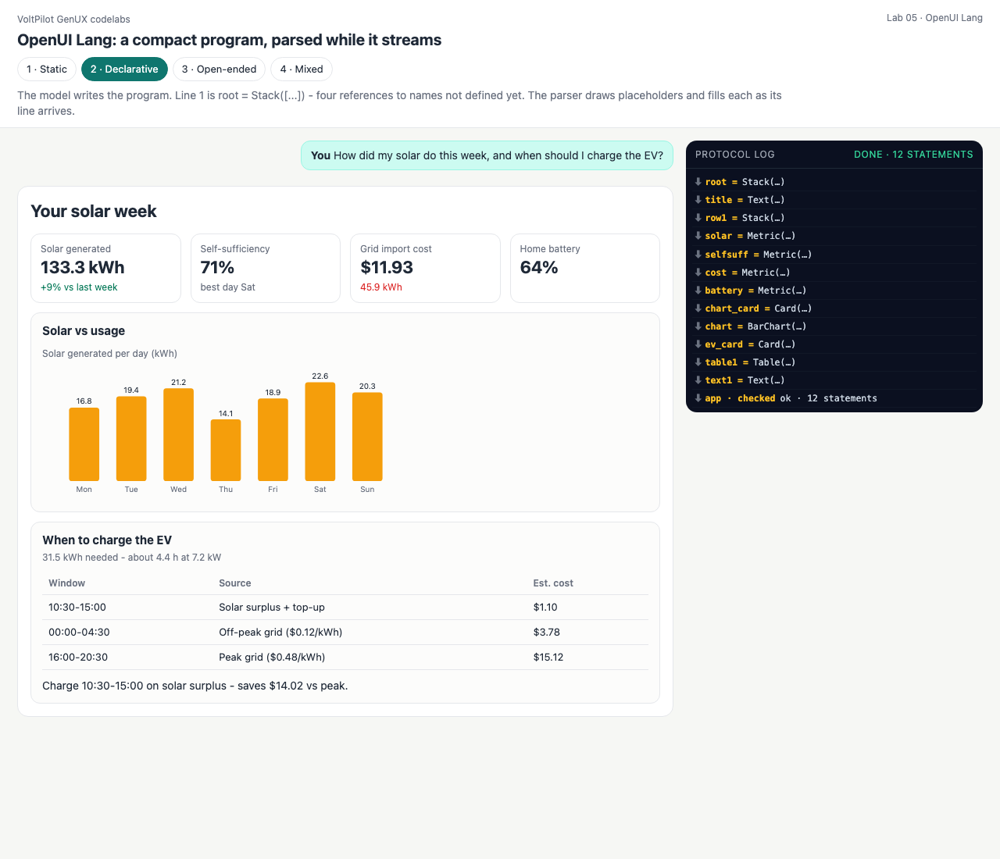
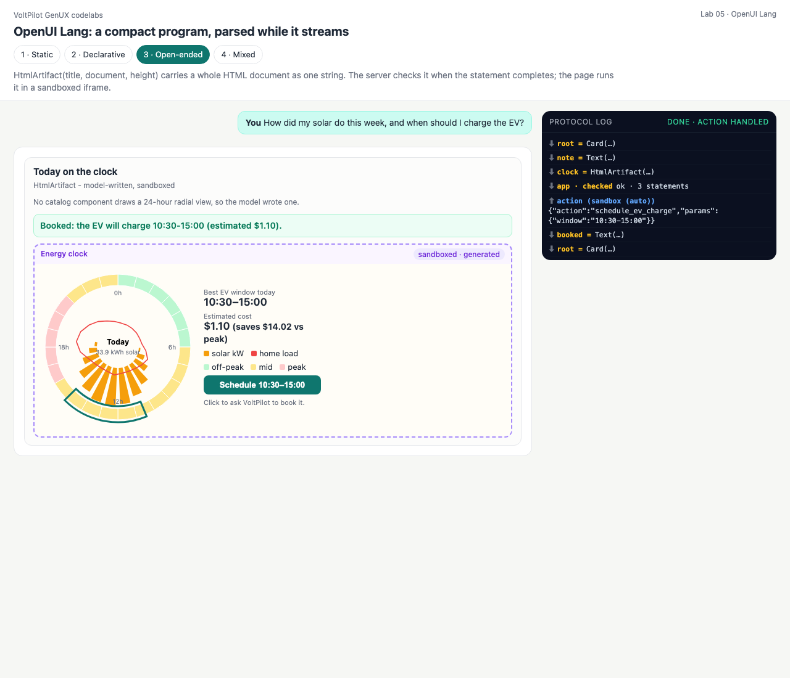
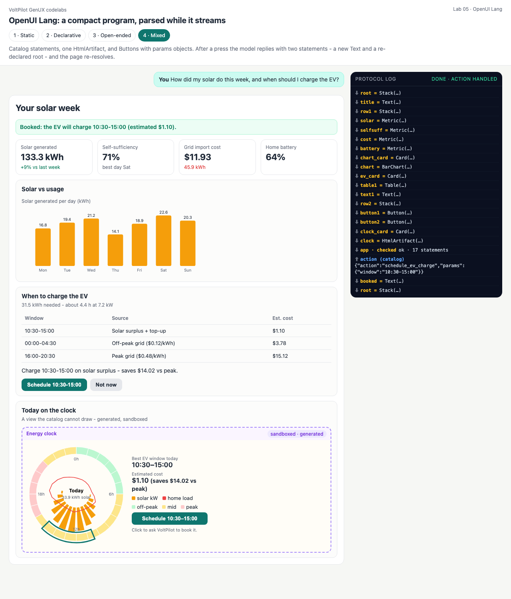

# Lab 05 · OpenUI Lang — a compact program, parsed while it streams

**OpenUI Lang** (thesys, `@openuidev/*`) describes a UI as a tiny program, one statement per line:

```
root = Stack([title, row1, chart_card, ev_card], "column", "m")
title = Text("Your solar week", "h1")
row1 = Stack([solar, selfsuff, cost, battery], "row", "m")
solar = Metric("Solar generated", "133.3 kWh", "+9% vs last week", "good")
...
```

Components take **positional** arguments (the catalog fixes their order), values are JSON-like, and a bare lowercase name is a **reference**. `root` comes first and refers to names defined later — those *forward references* are why the format streams well: the page draws a skeleton from line 1 and fills each placeholder when its line arrives. A later statement with the same name replaces the earlier one, so an edit is just more program.

| Mode | What the model emits | What the app controls |
|---|---|---|
| 1 · Static | a tool call `use_template(name, values)` | the program ([templates/*.oui](templates)); values become **literals** |
| 2 · Declarative | the program, streamed | the signatures (catalog) |
| 3 · Open-ended | `HtmlArtifact(title, document, height)` | content policy + sandbox |
| 4 · Mixed | catalog statements + one `HtmlArtifact` + Buttons with params objects | all of the above + action allow-list |

```bash
python3 labs/05_openui/declarative.py      # watch "pending refs" rise and fall as lines arrive
python3 serve.py                           # http://127.0.0.1:8765/labs/05_openui/?mode=declarative
```

**Verified with the official parser:** [conformance/formats.mjs](../../conformance/formats.mjs) parses all four programs with `@openuidev/lang-core@0.2.18`'s `parse()` — 0 unresolved references, 0 errors, and the **same tree** our parser produces.

## Code walkthrough — [openui.py](openui.py) (Python) and [openui-parse.js](openui-parse.js) (browser twin)

- [openui.py:26](openui.py#L26) `SIGNATURES` — the catalog as positional parameter lists (`Metric(label, value, delta, tone)` …).
- [openui.py:51](openui.py#L51) `tokenize()` and [`_Parser` (63)](openui.py#L63) — strings with escapes, numbers, `true/false/null`, `[arrays]`, `{objects}`, `Name(args)` calls, bare references.
- [openui.py:135](openui.py#L135) `Program` — [`feed()` (145)](openui.py#L145) completes statements at each newline; parse errors are collected, not raised; [`pending()` (176)](openui.py#L176) lists references not yet defined; [`tree()` (201)](openui.py#L201) resolves to the canonical tree with `__pending` placeholders and detects reference cycles.
- [openui.py:264](openui.py#L264) `from_tree()` — serializer used for the scripted replies (root first, parents before children).
- [oui_lab.py:43](oui_lab.py#L43) `fill()` — static templates: every slot value is json-encoded into a **literal**, so `x"), Button("Pay", ...` stays a string.
- [oui_lab.py:59](oui_lab.py#L59) `relay()` — forwards chunks; when an `HtmlArtifact` statement completes, its document gets the content policy and a refused statement is dropped on both sides.
- `tests/test_openui.py::ParityTest` feeds the same program to both parsers and requires identical trees.

---

## 1 · Static — templates with typed slots
<!-- output: 05_openui-static from="[app  ] template" n=8 -->
```text
  [app  ] template 'weekly_report' filled with slots ['advice', 'days', 'import_cost', 'self_sufficiency', 'solar', 'solar_by_day', 'solar_delta', 'week_label']
  line  1: root        = Card         pending refs:  3 (kpis, chart, advice)
  line  2: kpis        = Stack        pending refs:  5 (solar, selfsuff, cost, chart, advice)
  line  3: solar       = Metric       pending refs:  4 (selfsuff, cost, chart, advice)
  line  4: selfsuff    = Metric       pending refs:  3 (cost, chart, advice)
  line  5: cost        = Metric       pending refs:  2 (chart, advice)
  line  6: chart       = BarChart     pending refs:  1 (advice)
  line  7: advice      = Text         pending refs:  0
```
<!-- output: 05_openui-static from="an injection attempt" n=3 -->
```text
an injection attempt stays a string literal:
  root = Card("When to charge the EV", [windows, advice], "x\"), Button(\"Pay now\", \"transfer_funds")
  parsed root subtitle -> 'x"), Button("Pay now", "transfer_funds'; components: ['Card', 'Table', 'Text']
```

## 2 · Declarative — forward references while streaming
<!-- output: 05_openui-declarative from="line  1" n=13 -->
```text
  line  1: root        = Stack        pending refs:  4 (title, row1, chart_card, ev_card)
  line  2: title       = Text         pending refs:  3 (row1, chart_card, ev_card)
  line  3: row1        = Stack        pending refs:  6 (solar, selfsuff, cost, battery, chart_card, ...)
  line  4: solar       = Metric       pending refs:  5 (selfsuff, cost, battery, chart_card, ev_card)
  line  5: selfsuff    = Metric       pending refs:  4 (cost, battery, chart_card, ev_card)
  line  6: cost        = Metric       pending refs:  3 (battery, chart_card, ev_card)
  line  7: battery     = Metric       pending refs:  2 (chart_card, ev_card)
  line  8: chart_card  = Card         pending refs:  2 (chart, ev_card)
  line  9: chart       = BarChart     pending refs:  1 (ev_card)
  line 10: ev_card     = Card         pending refs:  2 (table1, text1)
  line 11: table1      = Table        pending refs:  1 (text1)
  line 12: text1       = Text         pending refs:  0

```
<!-- output: 05_openui-declarative from="size: OpenUI" n=1 -->
```text
size: OpenUI program 986 chars vs the same UI as a JSON element map 1783 chars (45% smaller; characters, not tokens)
```

## 3 · Open-ended — `HtmlArtifact`
<!-- output: 05_openui-open_ended from="the artifact's button" n=10 -->
```text
the artifact's button -> POST .../open_ended/action; the model replies with two statements:
  booked = Text("Booked: the EV will charge 10:30-15:00 (estimated $1.10).", "success")
  root = Card("Today on the clock", [note, booked, clock], "HtmlArtifact - model-written, sandboxed")

an artifact that loads a remote script is dropped before the page sees it:
  line  1: root        = Card         pending refs:  1 (a)
  [app  ] REFUSED a: HtmlArtifact refused - loads a remote URL
+-- x --------------------------------------------------------------------
  [waiting for a]
+-------------------------------------------------------------------------
```

## 4 · Mixed — an edit is more program
<!-- output: 05_openui-mixed from="press 'Schedule" n=8 -->
```text
press 'Schedule 10:30-15:00' -> the model's reply is more program:
  booked = Text("Booked: the EV will charge 10:30-15:00 (estimated $1.10).", "success")
  root = Stack([title, booked, row1, chart_card, ev_card, clock_card], "column", "m")

after applying it (first 3 lines of the terminal render):
YOUR SOLAR WEEK
Booked: the EV will charge 10:30-15:00 (estimated $1.10).
Solar generated: 133.3 kWh (+9% vs last week)  |  Self-sufficiency: 71% (best day Sat)  |  Grid import cost: $11.93 (45.9 kWh)  |  Home battery: 64%
```

| Static | Declarative | Open-ended (after the click) | Mixed (after the click) |
|---|---|---|---|
|  |  |  |  |

## Quiz

1. **After line 1 of the declarative stream there are 4 pending references; after line 3 there are 6. Why does the count go up?**
   <details><summary>Answer</summary>Line 3 defines `row1`, which itself refers to four metrics not yet defined: one reference resolved, four new ones appeared.</details>
2. **How does the mixed-mode reply add a confirmation without resending the dashboard?**
   <details><summary>Answer</summary>It defines `booked` and re-declares `root` with `booked` in its list; a later statement with the same name replaces the earlier one.</details>
3. **The OpenUI program is ~45% smaller than the same UI as a JSON element map. Is it 45% faster?**
   <details><summary>Answer</summary>Not necessarily — that is a character count, not tokens, and end-to-end latency also depends on the model, network and time to first useful paint. Measure before claiming speed.</details>
