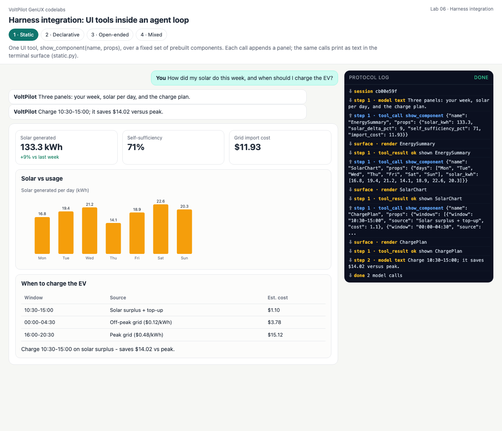
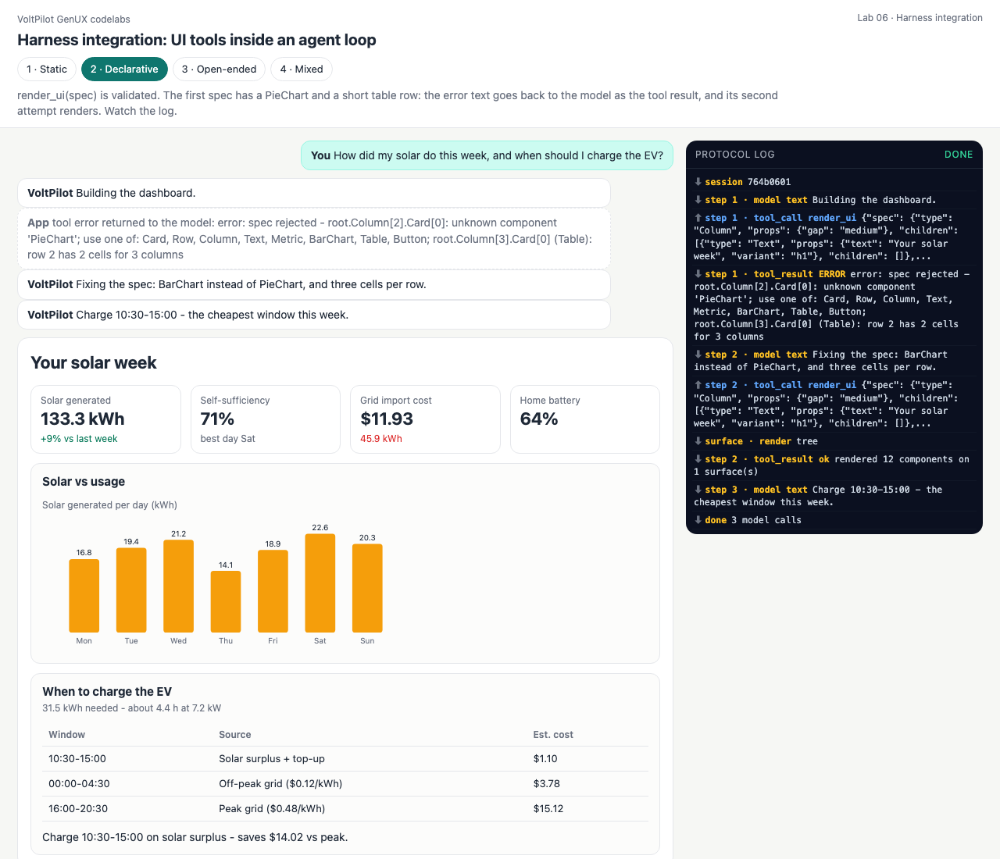
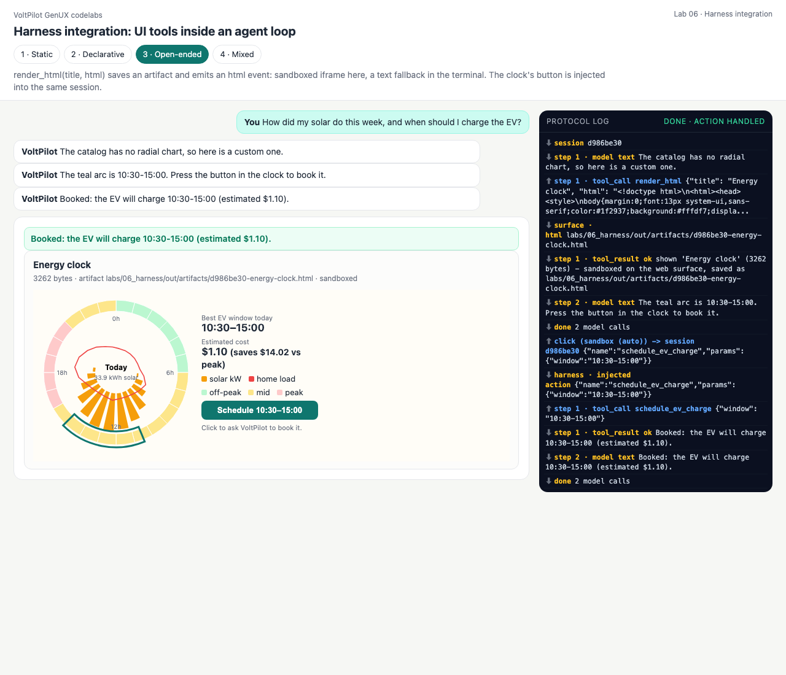
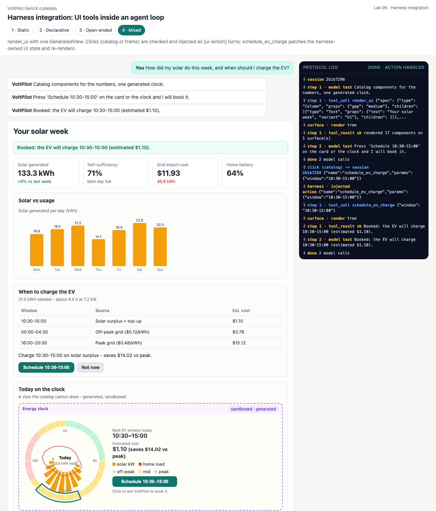

# Lab 06 · Harness integration — UI tools inside an agent loop

The other labs are *formats* and *transports*. This one is the **loop** they plug into: a minimal coding-agent harness ([harness.py](harness.py), ~170 lines) where a UI tool is just a tool whose side effect is "show something on every attached surface".

```
user text ─► [ model call ─► tool calls ─► tool results ─► model call ... ] ─► final text
                 │                 │
                 │                 └─ UI tools emit render / html events ──► TerminalSurface (prints)
                 │                                                       └─► WebSurface (SSE ─► page)
                 └─ bounded: MAX_STEPS = 8; every failure is a tool RESULT the model reads
page click ─► POST /api/06_harness/<mode>/action {session, action, params} ─► allow-list ─► "[ui-action] ..." user turn
```

| Mode | UI tool | What the model controls | Surfaces |
|---|---|---|---|
| 1 · Static | `show_component(name, props)` over 3 prebuilt components | which component + props | terminal + web |
| 2 · Declarative | `render_ui(spec)` — validated; **errors go back to the model** | the tree (catalog) | terminal + web |
| 3 · Open-ended | `render_html(title, html)` → saved artifact | the markup | web: sandboxed · terminal: fallback text |
| 4 · Mixed | `render_ui` with one `GeneratedView` + `schedule_ev_charge` | tree + one region | both; clicks injected into the session |

```bash
python3 labs/06_harness/declarative.py     # watch the self-correction loop
python3 serve.py                           # http://127.0.0.1:8765/labs/06_harness/?mode=mixed
```

## Code walkthrough — [harness.py](harness.py)

- [line 82](harness.py#L82) `Harness.run()` — the loop: [`for step in range(1, MAX_STEPS + 1)` (86)](harness.py#L86); stream the model; append the assistant turn; [`if not calls` → done (98)](harness.py#L98); otherwise run each call and [append its result as a `tool` message (108)](harness.py#L108).
- [line 121](harness.py#L121) `execute()` — unknown tool, invalid JSON, a raising tool: all become *results* (`"error: ..."`), never exceptions.
- [line 143](harness.py#L143) `ui()` — called by UI tools; sends the event to every surface and into the event stream.
- [line 111](harness.py#L111) `inject_action()` — a surface click becomes a user turn, after `labkit.check_action()`.
- [line 40](harness.py#L40) `TerminalSurface` / [line 59](harness.py#L59) `WebSurface` — the same events, two renderings.

**Tools** — [hx_tools.py](hx_tools.py): [`COMPONENTS` (25)](hx_tools.py#L25) and [`show_component()` (38)](hx_tools.py#L38) for static; [`make_render_ui()` (58)](hx_tools.py#L58) returns validator messages as the tool result; [`render_html()` (78)](hx_tools.py#L78) saves `labs/06_harness/out/artifacts/<session>-<title>.html`; [`schedule_ev_charge()` (98)](hx_tools.py#L98) patches the **harness-owned UI state** and re-renders; [`web_run()` (125)](hx_tools.py#L125) keeps sessions so clicks reach the same conversation.

---

## 1 · Static
<!-- output: 06_harness-static from="step 1 model" n=12 -->
```text
step 1 model: Three panels: your week, solar per day, and the charge plan.
step 1 tool_call  show_component({"name": "EnergySummary", "props": {"solar_kwh": 133.3, "solar_delta_pct": 9, "self_sufficiency_pct": 71, "imp...)
  ┌ surface: render ────────────────────────────────────────────────
  │ Solar generated: 133.3 kWh (+9% vs last week)  |  Self-sufficiency: 71%  |  Grid import cost: $11.93
  └──────────────────────────────────────────────────────────────────
step 1 tool_result ok  shown EnergySummary
step 1 tool_call  show_component({"name": "SolarChart", "props": {"days": ["Mon", "Tue", "Wed", "Thu", "Fri", "Sat", "Sun"], "solar_kwh": [16.8...)
  ┌ surface: render ────────────────────────────────────────────────
  │ +-- Solar vs usage -------------------------------------------------------
  │   Solar generated per day
  │      Mon ######################         16.8 kWh
  │      Tue ##########################     19.4 kWh
```

## 2 · Declarative — the self-correction loop
The first spec contains a `PieChart` (not in the catalog) and a table row with two cells for three columns ([declarative.py:33](declarative.py#L33)). The tool refuses it *with reasons*; the model's next step fixes both.
<!-- output: 06_harness-declarative from="step 1 model" n=6 -->
```text
step 1 model: Building the dashboard.
step 1 tool_call  render_ui({"spec": {"type": "Column", "props": {"gap": "medium"}, "children": [{"type": "Text", "props": {"text": "Your ...)
step 1 tool_result ERR error: spec rejected - root.Column[2].Card[0]: unknown component 'PieChart'; use one of: Card, Row, Column, Text, Metric, BarChart, Table, Button; root.Column[3].Card[0] (Table): row 2 has 2 cells for 3 columns
step 2 model: Fixing the spec: BarChart instead of PieChart, and three cells per row.
step 2 tool_call  render_ui({"spec": {"type": "Column", "props": {"gap": "medium"}, "children": [{"type": "Text", "props": {"text": "Your ...)
  ┌ surface: render ────────────────────────────────────────────────
```
<!-- output: 06_harness-declarative from="step 2 tool_result" n=5 -->
```text
step 2 tool_result ok  rendered 12 components on 1 surface(s)
step 3 model: Charge 10:30-15:00 - the cheapest window this week.
done after 3 model calls

1 rejected spec(s), then a valid one: the error text was the model's only feedback
```

## 3 · Open-ended — artifact + terminal fallback
<!-- output: 06_harness-open_ended from="step 1 model" n=22 -->
```text
step 1 model: The catalog has no radial chart, so here is a custom one.
step 1 tool_call  render_html({"title": "Energy clock", "html": "<!doctype html>\n<html><head><style>\nbody{margin:0;font:13px system-ui,san...)
  ┌ surface: generated HTML - Energy clock (3262 bytes)
  │ terminals cannot run it; saved as labs/06_harness/out/artifacts/0f44ee9d-energy-clock.html
  └ open the web surface (python3 serve.py) to see it sandboxed
step 1 tool_result ok  shown 'Energy clock' (3262 bytes) - sandboxed on the web surface, saved as labs/06_harness/out/artifacts/0f44ee9d-energy-clock.html
step 2 model: The teal arc is 10:30-15:00. Press the button in the clock to book it.
done after 2 model calls

the web surface relays a click from the frame into the same session:
surface action -> schedule_ev_charge {'window': '10:30-15:00'}
step 1 tool_call  schedule_ev_charge({"window": "10:30-15:00"})
step 1 tool_result ok  Booked: the EV will charge 10:30-15:00 (estimated $1.10).
step 2 model: Booked: the EV will charge 10:30-15:00 (estimated $1.10).
done after 2 model calls

and a forged action never reaches the model:
ERROR action refused: action 'open_garage' is not allowed; allowed: ['dismiss', 'schedule_ev_charge']
```

## 4 · Mixed — clicks injected into the loop
<!-- output: 06_harness-mixed from="web surface click" n=6 -->
```text
web surface click -> POST /api/06_harness/mixed/action {session, action, params}
surface action -> schedule_ev_charge {'window': '10:30-15:00'}
step 1 tool_call  schedule_ev_charge({"window": "10:30-15:00"})
  ┌ surface: render ────────────────────────────────────────────────
  │ YOUR SOLAR WEEK
  │ Booked: the EV will charge 10:30-15:00 (estimated $1.10).
```
<!-- output: 06_harness-mixed from="step 1 tool_result" n=4 -->
```text
step 1 tool_result ok  rendered 17 components on 1 surface(s)
step 2 model: Press 'Schedule 10:30-15:00' on the card or the clock and I will book it.
done after 2 model calls

```

| Static | Declarative (after self-correction) | Open-ended (after the click) | Mixed (after the click) |
|---|---|---|---|
|  |  |  |  |

## Quiz

1. **Why return a validation error as a tool result instead of raising?**
   <details><summary>Answer</summary>The model is the only party that can fix its spec; a result puts the exact problems in its context for the next step. Raising would end the turn with nothing learned.</details>
2. **What stops a model that never produces a valid spec?**
   <details><summary>Answer</summary>`MAX_STEPS = 8`; `tests/test_harness.py::test_steps_are_bounded` drives a model that always fails and checks the loop ends with an error after 8 tool calls.</details>
3. **Why does the terminal surface print a placeholder for the GeneratedView?**
   <details><summary>Answer</summary>A terminal cannot run HTML. The harness emits the same event to every surface; each surface degrades in its own way (the web surface sandboxes it, the terminal points to the saved artifact).</details>
